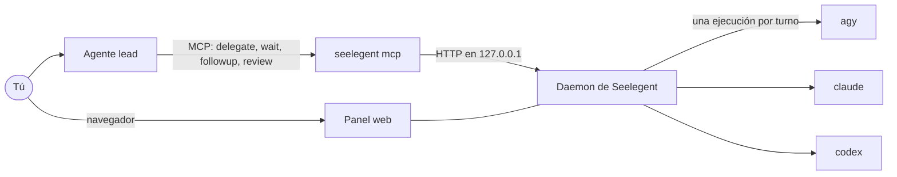

# Seelegent

[English](README.md) · [Tiếng Việt](README.vi.md) · [简体中文](README.zh-CN.md) · **Español** ·
[한국어](README.ko.md) · [日本語](README.ja.md) · [Русский](README.ru.md)

Seelegent permite que un agente de programación principal (el lead) reparta trabajo entre workers: CLI de programación
que se ejecutan con tus propias cuentas. Tú hablas con el lead (Claude Code, Codex, Antigravity, OpenCode u otro host
MCP); el lead diseña el trabajo, escribe un brief y lo delega por MCP; Seelegent lo ejecuta como una llamada normal y no
interactiva a una CLI (`agy`, `claude` o `codex`) en la cuenta con más cuota disponible, comprueba el resultado y le
devuelve el informe al lead para que lo revise. Está pensado para quien tiene varias suscripciones o claves de API y
quiere que un agente planifique y revise mientras los demás escriben el código.

Seelegent no es un proxy ni agrupa cuentas detrás de un único punto de acceso. Cada ejecución es una llamada normal a
una CLI en una cuenta tuya, dentro de su propio perfil aislado, y los términos de cada proveedor siguen aplicándose a
cada cuenta.

## Cómo funciona



- **Un solo binario.** `seelegent` es a la vez el daemon, la línea de comandos, el servidor MCP que arranca el host del
  lead (`seelegent mcp`) y el panel web.
- **El daemon** solo escucha en `127.0.0.1:47821`. Elige la cuenta, ejecuta el worker, registra cada paso, pasa los
  controles y sobrevive a los reinicios: el siguiente daemon retoma los workers que siguen en marcha.
- **Los workers** son las mismas CLI que ya usas, cada cuenta con su propia carpeta de perfil. Si una cuenta se queda
  sin cuota a mitad de una tarea, descansa hasta que se renueve su ventana y la tarea pasa a otra cuenta con un
  traspaso.
- **El panel web** (http://127.0.0.1:47821/) muestra lo que te necesita, lo que está en marcha, los pasos y el diff de
  cada tarea, las cuentas y su cuota, y todo lo que se describe más abajo.

## Requisitos

- **Sistema:** Windows 10 u 11, Linux o macOS, en x64 o ARM64. Windows es la plataforma más probada.
- **Git.** Seelegent lo necesita para las instantáneas, la vista Git, los concursos y los tickets de GitHub.
- **Al menos una CLI de worker** instalada: Antigravity CLI (`agy`, modelos Gemini, el backend por defecto), Claude
  Code (`claude`) o Codex (`codex`). Los backends `claude` y `codex` están apagados hasta que los actives en Ajustes.
- **Un host para el lead** con MCP: Claude Code, Claude Desktop, Codex CLI, OpenCode, Antigravity CLI o la aplicación
  Antigravity, Gemini CLI, Cursor o Windsurf. Un host sin MCP puede usar el comando `seelegent`.
- Opcional: la CLI de GitHub (`gh`) con sesión iniciada, para las funciones de GitHub.

## Instalación

Windows (PowerShell):

```powershell
irm https://raw.githubusercontent.com/NovaSeele/Seelegent/main/scripts/install.ps1 | iex
```

Linux y macOS:

```sh
curl -fsSL https://raw.githubusercontent.com/NovaSeele/Seelegent/main/scripts/install.sh | sh
```

El instalador descarga la última versión, comprueba su SHA-256 con el `checksums.txt` de la versión, pone `seelegent`
en el PATH (`%LOCALAPPDATA%\Programs\seelegent\bin` en Windows, `~/.local/bin` en los demás sistemas), importa los
datos de la versión antigua si los encuentra y ejecuta `seelegent setup` para los hosts del lead de esta máquina.
Después, abre una terminal nueva y reinicia los hosts del lead. Las opciones como `--version`, `--install-dir` y
`--no-setup` (sh) o `-Version`, `-InstallDir` y `-NoSetup` (PowerShell) están en
[docs/release.md](docs/release.md#installing).

## Primeros pasos

1. **Comprueba la instalación:** `seelegent doctor`.
2. **Abre el panel web:** `seelegent ui` arranca el daemon si hace falta y abre http://127.0.0.1:47821/.
3. **Añade una cuenta** en la página **Cuentas**: elige el backend y el tipo (sesión propia, sesión de este equipo o
   clave de API a través de un proveedor). El inicio de sesión ejecuta el de la propia CLI del worker, en el navegador
   o en una ventana de terminal; Seelegent nunca ve tu contraseña. Para usar `claude` o `codex`, activa antes el backend
   y asigna los modelos de cada nivel en **Ajustes › Backends**.
4. **Conecta el host del lead** (el instalador ya lo hizo): `seelegent setup` añade el servidor MCP `seelegent` a cada
   host del lead que encuentra e instala la skill del lead donde el host lee skills. `--host claude,codex` elige los
   hosts, `--dry-run` muestra antes los cambios y `--remove` los deshace. Reinicia el host.
5. **Delega.** En la carpeta de un proyecto, pídele al lead algo como *«Usa Seelegent para añadir validación de datos
   al formulario de registro y luego revisa el diff»*. El lead llama a `delegate`, espera el informe, lee el diff, pasa
   los tests y después envía un `followup` o cierra la tarea con `review`. Desde una terminal:
   `seelegent delegate --cwd . --model fast "Describe this project in five lines"`.

[docs/getting-started.md](docs/getting-started.md) (en inglés) explica cada paso en detalle.

## Funciones

**Workers y cuentas.** Tres backends (`agy`, `claude`, `codex`) y tres tipos de cuenta: un perfil aislado con su
propia sesión, la sesión que ya existe en este equipo (solo `agy`) o una clave de API de un proveedor (solo `claude`
y `codex`: Anthropic, DeepSeek, Moonshot Kimi, Z.ai GLM, OpenRouter, OpenAI, Groq, un Ollama local o un endpoint
propio). El grupo de cuentas lee las ventanas
de cuota de cada cuenta y prefiere la de mayor prioridad, con menos tareas en marcha y más cuota restante. Los niveles
de modelo `fast`, `standard`, `strong` y `max` se asignan a modelos reales en cada backend. Consulta la
[configuración](docs/configuration.md).

**Tareas.** Una tarea es una conversación: `delegate`, luego tantos `followup` como hagan falta y al final `review`
con `accepted` o `rejected`. Las tareas se ejecutan en paralelo, pueden esperarse entre sí (`after`), reciben en cada
brief la memoria del proyecto y el historial de revisiones, pueden ejecutarse con un rol de worker (reglas, estilo de
informe, skills, nivel por defecto) y pueden recibir la carpeta de una funcionalidad y los ids de tarea de Spec Kit en
lugar de toda la especificación. Las tareas que se atascan, entran en bucle o hacen una pregunta despiertan antes al
lead, y las que te necesitan (falta iniciar sesión, no quedan cuentas) suben al principio del panel. Puedes **tomar el
control** de una tarea en una consola y devolvérsela después al worker. Consulta el
[motor de tareas](docs/task-engine.md).

**Controles, carriles y pruebas.** Tras cada informe del worker, el daemon ejecuta el gate de la tarea: los comandos
del lead, las líneas `Gate:` de la especificación o los comandos de test, lint y build detectados en el repositorio, la
doctrina del proyecto, comprobaciones de sintaxis y la de higiene. Un gate **fallido** vuelve al worker como turno de
corrección automática (2 por defecto) antes de despertar al lead. Los carriles indican qué archivos puede cambiar una
tarea, para que los workers en paralelo no se pisen. Opcionalmente, una segunda revisión de solo lectura repasa el
cambio cuando el gate se ha superado. La página **Pruebas** muestra qué requisitos de Spec Kit están probados y lanza
ejecuciones de regresión. Consulta los [gates](docs/gates.md).

**Equipo.** Los miembros son workers con nombre, con un backend, un modelo o nivel, un rol y un rango (trabajador,
sénior, par: `worker`, `senior`, `peer`). Puedes pedir a un sénior o a un par una segunda opinión sobre una tarea
terminada (la objeción de un par bloquea la aceptación hasta que el lead la responda), dejar notas de revisión en
líneas del diff y enviarlas juntas como un solo `followup`, reunir hasta seis miembros antes de una decisión difícil
(un par puede dejar constancia de un disenso formal) o convertir un brief en un concurso de 2 a 5 variantes en
worktrees separados y aplicar la ganadora. Los hooks de eventos ejecutan tus propios comandos de shell ante eventos de
tareas, cuentas y del daemon (una tarea empieza, termina o se bloquea, una cuenta se queda sin cuota o necesita iniciar
sesión, y más). Consulta el [equipo](docs/team.md).

**GitHub.** Conecta un repositorio, sincroniza sus issues abiertos en una bandeja (o añade issues locales) y clasifica
cada uno en un ticket: su propio worktree y su propia rama, en los que trabajan una o varias tareas. Cuando el trabajo
está aceptado, tú o el lead le pedís a Seelegent que haga commit, suba la rama del ticket y abra un pull request en
borrador; después sigue los checks de CI y puede lanzar una tarea para arreglar los que fallen. Usa `gh` si tiene la
sesión iniciada, si no un token que guardas en el panel y, si tampoco, un modo manual con un enlace de comparación.
Consulta [GitHub](docs/github.md).

**Rutinas.** Delegaciones guardadas que se ejecutan con un horario (cada hora, cada día, entre semana, cada semana o
cron, en una zona horaria), con un comando de comprobación previa y reglas de cuota: una ejecución se salta si queda
poca cuota, y una ejecución extra opcional aprovecha la cuota semanal que está a punto de renovarse sin usar. Consulta
las [rutinas](docs/automations.md).

**Panel web.** Páginas Panel, Tareas, Issues, Reuniones, Concursos, Rutinas, Pruebas, Cuentas, Uso, Roles y Miembros,
y un diálogo de Ajustes con búsqueda. Cada tarea tiene las vistas Terminal, Árbol, Grafo, Archivos y Git. 26 temas de
color, siete idiomas, una paleta de comandos (`Ctrl+K`, `Cmd+K` en macOS) y atajos de teclado. Va integrado en el
binario y no carga nada de internet.

**Línea de comandos.** Cada herramienta MCP salvo `profiles` tiene su comando (los roles de worker se editan en la
página **Roles** y con la herramienta `profiles`) y todos los comandos aceptan `--json`: consulta `seelegent --help` y
[docs/cli.md](docs/cli.md).

### Herramientas MCP para el lead

| Herramienta | Qué hace |
|---|---|
| `delegate` | Inicia una tarea (o un concurso) y espera el informe del worker. |
| `wait` | Espera una o varias tareas; `any: true` vuelve con la primera. |
| `followup` | Envía la siguiente instrucción o las correcciones de una tarea. |
| `review` | Cierra una tarea como `accepted` o `rejected`, con notas. |
| `cancel` | Detiene una tarea en marcha o en cola. |
| `task` | El informe de una tarea y los últimos pasos del worker. |
| `status` | Cuentas y cuota, tareas activas, backends. |
| `memory` | Notas por proyecto que se incluyen en cada brief. |
| `profiles` | Roles de worker: reglas, estilo de informe, skills, nivel por defecto. |
| `proof` | Matriz de requisitos, ejecuciones de regresión, carriles reservados, estadísticas. |
| `members` | Los miembros del departamento. |
| `consult` | Una segunda opinión de un sénior o un par sobre una tarea terminada. |
| `notes` | Notas de revisión sobre el diff de una tarea, enviadas como un solo `followup`. |
| `meeting` | Una reunión estructurada de miembros antes de decidir. |
| `contest` | Seguir un concurso y elegir la ganadora. |
| `issues` | De issues de GitHub a tickets, worktrees y pull requests en borrador. |
| `automations` | Delegaciones programadas. |

`seelegent setup` también instala la skill del lead, que le enseña este ciclo; `seelegent skill` la muestra. Más
detalles en [docs/mcp.md](docs/mcp.md).

## Seguridad

Los workers trabajan en carpetas donde tú y otros workers tenéis cambios sin confirmar. Seelegent los protege por
capas; ninguna hace fallar una tarea por sí sola, sino que cuentan al lead y al panel lo que ha pasado. Consulta
[docs/safety.md](docs/safety.md).

- **Protección de Git.** Los workers no pueden ejecutar comandos de git que puedan tirar trabajo sin confirmar o
  reescribir el historial: `reset`, `restore`, `stash`, `checkout` (salvo `checkout -b` para crear una rama),
  `switch`, `clean`, `rebase`, `merge`, `pull`, `push`, `commit -a` y `--amend`, entre otros, también dentro de
  `bash -c`, PowerShell, tuberías hacia una shell o alias de git. El lead puede levantarla durante un turno con
  `allow_git`.
- **Instantáneas.** Antes y después de cada turno, Seelegent registra los archivos sin confirmar del repositorio sin
  tocar tu index, tu stash ni tus refs. Los archivos que el turno pudo perder aparecen *en riesgo*, con un botón
  **Restaurar** en el panel y el comando `seelegent restore`.
- **Comprobaciones tras el turno.** Los cambios de fin de línea o de BOM, los archivos sobrantes, las escrituras fuera
  del proyecto y los solapamientos con otras tareas se señalan en la tarea.
- **Lo que un worker no puede hacer.** Un worker no puede llamar a Seelegent (no puede crear, cambiar ni revisar
  tareas), no puede activar una rutina y no puede guardar un token de GitHub. Las dos últimas cosas solo puedes
  hacerlas tú, en el panel.
- **Antes de un push.** Seelegent sube un único commit propio, nunca los commits del worker, y solo después de revisar
  cada archivo que añade: archivos `.env`, claves y certificados, archivos de credenciales, tokens dentro del
  contenido, nombres de dispositivo de Windows como `nul` y archivos de más de 5 MB impiden el push, sin forma de
  saltárselo. Nunca hace force-push, ni merge, ni cierra issues.
- **Las rutinas empiezan apagadas.** Toda rutina se crea desactivada. Solo se ejecuta cuando confirmas en el panel
  exactamente lo que hace, y cualquier cambio en lo que ejecuta o en cuándo lo hace la vuelve a apagar.

Son protecciones, no un sandbox: las CLI de los workers se ejecutan con tu usuario. Revisa lo que cambian.

## Datos y privacidad

- Todo se ejecuta en tu equipo. El daemon solo escucha en `127.0.0.1`. Seelegent en sí no envía telemetría; las CLI
  de los workers siguen sus propios ajustes.
- Los datos están en `~/.seelegent` (define `SEELEGENT_HOME` para moverlos): `config.json` (ajustes), `seelegent.db`
  (tareas, cuentas, uso, equipo, tickets, rutinas), `profiles/` (un perfil aislado por cuenta, con su clave de API),
  `github/` (el token), `snapshots/`, `contests/` (los diffs guardados de los concursos), `worktrees/` (solo para
  concursos y tickets), `run/` y `logs/`. Consulta [docs/configuration.md](docs/configuration.md).
- Seelegent nunca pide contraseñas. Cada CLI de worker inicia sesión con su propio flujo y guarda sus tokens en el
  perfil de la cuenta. Las claves de API y el token de GitHub se guardan cada uno en su propio archivo, cifrados con
  DPAPI en Windows y como texto plano legible solo por su dueño (0600) en los demás sistemas; el panel muestra solo los
  cuatro últimos caracteres y los registros ocultan los secretos.
- Lo que sale de tu equipo: las CLI de los workers hablan con sus propios proveedores (ese es el trabajo), la cuota se
  lee a través de las CLI (y, en las cuentas de Claude con sesión, del endpoint de uso de Anthropic con la propia sesión
  de esa cuenta), las cuentas con clave de API llaman al proveedor que configuraste, y a GitHub solo se le llama por los
  repositorios que conectas (sincronización, una consulta de sus issues y pull requests cada 10 minutos, que
  `githubPollMinutes: 0` desactiva, y los push, pull requests y comentarios que pides tú o el lead), para comprobar tu
  sesión de GitHub cuando abres **Issues**, y desde los instaladores y `seelegent update`.

## Actualizar y desinstalar

`seelegent update` te dice si hay una versión nueva; `seelegent update --apply` la instala en el mismo sitio
(comprobada con `checksums.txt`, con el daemon reiniciado y los hosts del lead actualizados) y
`seelegent update --rollback` vuelve atrás una vez. La base de datos nunca se migra hacia atrás, así que se rechaza una
versión más antigua que tus datos. Consulta [docs/release.md](docs/release.md#updating).

Para desinstalar:

1. `seelegent stop` y después `seelegent setup --remove` (quita las entradas MCP, la skill del lead y el hook).
2. Borra el binario y el `seelegent.exe.previous` (`seelegent.previous`) que se guarda a su lado:
   `%LOCALAPPDATA%\Programs\seelegent\bin\` en Windows, `~/.local/bin/seelegent*` en los demás sistemas. Quita esa
   carpeta del PATH (el `Path` de usuario en Windows; en los demás, la línea `export PATH=...` que el instalador añadió
   al perfil de tu shell).
3. Si quieres, borra `~/.seelegent`. Contiene los perfiles de tus cuentas (con sus sesiones), las claves, las tareas y
   el historial.

## Migrar desde la versión antigua

La antigua versión en Node guardaba sus datos en la misma carpeta. En la primera instalación, el instalador ejecuta
`seelegent migrate`, que importa los ajustes, los proveedores, las cuentas con sus perfiles y claves de API, la memoria
de los proyectos y el historial de revisiones, los roles, los miembros, los hooks, las actas de reuniones y las rutinas
(todas apagadas, para confirmarlas de nuevo). No se importan las tareas, las notas de revisión, los concursos, los
registros de pruebas, el historial de uso ni la carpeta de GitHub: vuelve a conectar tus repositorios y a guardar el
token. La carpeta antigua nunca se modifica. En Windows, si el lanzador antiguo está en la carpeta de instalación, se
conserva como `seelegent-node`. Detén el daemon antiguo antes de instalar y ejecuta `seelegent migrate --dry-run` para
ver qué se importaría. Consulta [docs/setup.md](docs/setup.md#seelegent-migrate).

## Solución de problemas

- `seelegent doctor` revisa la carpeta de datos, los ajustes, la base de datos, el daemon, git, cada CLI de worker
  activada, las cuentas y el PATH, y explica cómo arreglar lo que falla. No cambia nada, salvo una prueba de escritura
  en la carpeta de datos (`.doctor-write-test`, que borra enseguida).
- `seelegent status` muestra el daemon, las cuentas con su cuota y las tareas que te necesitan; `seelegent restart`
  reinicia el daemon. Su registro es `~/.seelegent/logs/daemon.log`.
- `seelegent setup --dry-run` muestra lo que hay registrado en cada host del lead. Reinicia el host después de un setup
  o una actualización.
- «Seelegent is not available inside a Seelegent worker.» significa que un worker intentó llamar a Seelegent; se
  rechaza a propósito.
- Una tarea en **Te necesitan** explica el motivo en su aviso: responde a su pregunta, inicia sesión en una cuenta,
  restaura los archivos en riesgo o pide más cambios si el gate ha fallado.

## Documentación

Toda la documentación (en inglés) está listada en [docs/README.md](docs/README.md): una guía de inicio para usuarios,
la referencia para el lead, la línea de comandos, la API HTTP y la guía para quien quiera contribuir.

## Licencia

El código de Seelegent está disponible (source-available) bajo la
[Functional Source License 1.1, Apache 2.0 Future License (FSL-1.1-ALv2)](LICENSE).

- Puedes usarlo, modificarlo y compartirlo con cualquier fin, también dentro de una empresa, y crear y vender tus
  propios productos con él.
- No puedes ofrecer Seelegent, ni una copia modificada, a terceros como producto o servicio comercial que compita con
  él.
- Dos años después de publicarse cada versión, esa versión también queda disponible bajo la Apache License 2.0.

El archivo [LICENSE](LICENSE) contiene los términos exactos. Las obras de terceros incluidas en Seelegent se enumeran
en [THIRD_PARTY_NOTICES.md](THIRD_PARTY_NOTICES.md).
