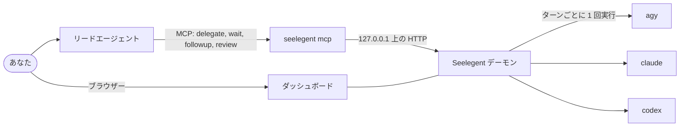

<div align="center">


**計画とレビューは 1 つのリードエージェントが、コードはあなた自身のアカウントで動くコーディング CLI が書きます。**

[インストール](#インストール) · [クイックスタート](#クイックスタート) · [使い方ガイド](docs/usage.md) ·
[ドキュメント](docs/README.md) · [コントリビュート](CONTRIBUTING.md)

[English](README.md) · [Tiếng Việt](README.vi.md) · [简体中文](README.zh-CN.md) · [Español](README.es.md) ·
[한국어](README.ko.md) · **日本語** · [Русский](README.ru.md)

[](LICENSE)
[](https://github.com/NovaSeele/Seelegent/releases/latest)
[](go.mod)
[](#動作環境)
[](https://github.com/NovaSeele/Seelegent/actions/workflows/ci.yml)

</div>

<p align="center">
  <a href="docs/media/hero.mp4"></a>
</p>

Seelegent は、1 つのリードコーディングエージェントが、あなた自身のアカウントで動くワーカー (コーディング CLI) に
作業を任せるためのツールです。あなたはリード (Claude Code、Codex、Antigravity、OpenCode などの MCP ホスト) とだけ
話します。リードが作業を設計してブリーフを書き、MCP 経由で委任すると、Seelegent はクォータが最も多く残っている
アカウントで、それを通常の非対話型 CLI 呼び出し (`agy`、`claude`、`codex`) として実行し、結果をチェックして、
レビュー用のレポートをリードに返します。複数のサブスクリプションや API キーを持ち、計画とレビューは 1 つの
エージェントに、コードを書くのは他のエージェントに任せたい人のためのツールです。

Seelegent はプロキシではなく、複数のアカウントを 1 つのエンドポイントの裏にまとめることもしません。どの実行も、
あなたが所有するアカウントの独立したプロファイルで行われる通常の CLI 呼び出しであり、各アカウントには各提供元の
規約がそのまま適用されます。

## 機能

- **いつものリードからそのまま委任。** リードは MCP で `delegate`、`wait`、`followup`、`review` を呼び、Seelegent は
  各ターンを通常のワーカー CLI 呼び出し 1 回として実行してレポートを返します。→ [MCP ツール](docs/mcp.md)
- **対応が必要なものから先に。** **監視** ページは、質問がある、サインインが必要、ゲートに失敗した、ファイルが失われた
  おそれがあるタスクを先頭に出し、それぞれに何をすべきかを示すバナーを付けます。→
  [タスクが止まったとき](docs/getting-started.md#7-when-something-is-stuck)
- **すべてのステップを記録。** 各タスクにはターミナル、ツリー、グラフ、ファイル、Git のビューがあり、会話、すべての
  ツール呼び出し、ターンと試行、行ごとにレビューノートを付けられる差分を確認できます。→
  [タスクエンジン](docs/task-engine.md)
- **アカウントは複数、プールは 1 つ。** 専用のサインイン、このコンピューターのサインイン、API キーから、優先度、
  実行中のタスク数、残りのクォータでアカウントを選びます。クォータが尽きたアカウントのタスクは、引き継ぎ情報とともに
  別のアカウントへ移ります。→ [設定](docs/configuration.md)
- **ゲートが失敗した作業を差し戻す。** レポートのたびにデーモンがテスト、lint、ビルドを実行し、失敗したゲートは
  自動修正ターンとしてワーカーに戻します。**証拠** ページでは Spec Kit の要件のどれが証明済みかを追えます。→
  [ゲート、レーン、証拠](docs/gates.md)
- **未コミットの作業はそのまま残る。** Git ガードが作業を捨てうる git コマンドを拒否し、各ターン前後のスナップショット
  から、そのターンで失われたかもしれないファイルを復元できます。→ [安全性](docs/safety.md)
- **ワーカーだけでなくチームで。** 名前とランクを持つメンバーがセカンドオピニオンを出し、難しい判断の前に会議を開き、
  同じブリーフを別々の worktree で 2〜5 個のバリアントとして競わせます。→ [チーム](docs/team.md)
- **issue からドラフトの pull request まで、またはスケジュールで。** GitHub の issue を専用の worktree とブランチを
  持つチケットに振り分け、秘密情報のスキャン後にドラフトの pull request を作り、保存した委任をスケジュールで
  実行します。→ [GitHub](docs/github.md) · [自動化](docs/automations.md)
- **マシンに合わせた値。** ゲートの同時実行数、メモリーのしきい値、テストの並列度は、このマシンのメモリーと CPU から
  計算されます。**設定 › リソース** でどの値も自分で決めたり、自動に戻したりできます。→
  [リソース](docs/configuration.md#resources)
- **セットアップも点検もコマンド 1 つ。** `seelegent setup` は MCP サーバーとリード用スキルを 9 種類のリード用ホストに
  登録し、`seelegent doctor` はインストールを点検して、失敗した項目の直し方を示します。→
  [セットアップ](docs/setup.md) · [doctor](docs/cli.md#doctor)

### 実際の動き

プレビューをクリックすると短い動画が開きます。

<table>
  <tr>
    <td width="50%" align="center">
      <a href="docs/media/delegate.mp4"></a><br>
      <b>委任</b>
    </td>
    <td width="50%" align="center">
      <a href="docs/media/needs-you.mp4"></a><br>
      <b>要対応</b>
    </td>
  </tr>
  <tr>
    <td width="50%" align="center">
      <a href="docs/media/task-detail.mp4"></a><br>
      <b>タスクの詳細</b>
    </td>
    <td width="50%" align="center">
      <a href="docs/media/accounts.mp4"></a><br>
      <b>アカウントとクォータ</b>
    </td>
  </tr>
  <tr>
    <td width="50%" align="center">
      <a href="docs/media/gates-proof.mp4"></a><br>
      <b>ゲートと証拠</b>
    </td>
    <td width="50%" align="center">
      <a href="docs/media/git-guard.mp4"></a><br>
      <b>Git ガードと復元</b>
    </td>
  </tr>
  <tr>
    <td width="50%" align="center">
      <a href="docs/media/team.mp4"></a><br>
      <b>チーム</b>
    </td>
    <td width="50%" align="center">
      <a href="docs/media/github-automations.mp4"></a><br>
      <b>GitHub と自動化</b>
    </td>
  </tr>
  <tr>
    <td width="50%" align="center">
      <a href="docs/media/resources.mp4"></a><br>
      <b>リソース</b>
    </td>
    <td width="50%" align="center">
      <a href="docs/media/setup-doctor.mp4"></a><br>
      <b>setup と doctor</b>
    </td>
  </tr>
</table>

## 動作環境

- **OS:** Windows 10 または 11、Linux、macOS (x64 または ARM64)。最もよくテストされているのは Windows です。
- **Git。** スナップショット、Git ビュー、コンテスト、GitHub のチケットに必要です。
- **ワーカー CLI を 1 つ以上**: Antigravity CLI (`agy`、Gemini モデル、既定のバックエンド)、Claude Code
  (`claude`)、Codex (`codex`)。`claude` と `codex` のバックエンドは、設定でオンにするまでオフです。
- **MCP 対応のリード用ホスト**: Claude Code、Claude Desktop、Codex CLI、OpenCode、Antigravity CLI またはアプリ、
  Gemini CLI、Cursor、Windsurf。MCP のないホストでは、代わりに `seelegent` コマンドを使えます。
- 任意: GitHub 機能を使うなら、サインイン済みの GitHub CLI (`gh`)。

## インストール

**Windows** (PowerShell):

```powershell
irm https://raw.githubusercontent.com/NovaSeele/Seelegent/main/scripts/install.ps1 | iex
```

**Linux と macOS:**

```sh
curl -fsSL https://raw.githubusercontent.com/NovaSeele/Seelegent/main/scripts/install.sh | sh
```

インストーラーは最新リリースをダウンロードし、リリースの `checksums.txt` で SHA-256 を検証し、`seelegent` を PATH に
置き (Windows は `%LOCALAPPDATA%\Programs\seelegent\bin`、それ以外は `~/.local/bin`)、旧バージョンのデータがあれば
取り込み、このマシンのリード用ホストに対して `seelegent setup` を実行します。終わったら新しいターミナルを開き、
リード用ホストを再起動してください。`--version`、`--install-dir`、`--no-setup` (sh) や `-Version`、`-InstallDir`、
`-NoSetup` (PowerShell) などのオプションは [docs/release.md](docs/release.md#installing) にあります。ソースから
ビルドする方法は [CONTRIBUTING.md](CONTRIBUTING.md#development-setup) を参照してください。

## クイックスタート

1. **インストールを確認:** `seelegent doctor`。新しいインストールでは `warn` が出ても問題ありません。`fail` には
   直し方が添えられます。
2. **リード用ホストを接続:** インストーラーが `seelegent setup` を実行済みです。これは見つかったすべてのリード用
   ホストに `seelegent` MCP サーバーを追加し、リード用スキルを入れます。新しいホストを入れたら再度実行し
   (`--dry-run` で変更を先に確認、`--remove` で元に戻す)、ホストを再起動してください。
3. **アカウントを追加:** `seelegent ui` は必要ならデーモンを起動し、http://127.0.0.1:47821/ を開きます。
   **アカウント** で **アカウントを追加** を選び、バックエンドと種類を決めてから **サインイン** します。ワーカー CLI
   自身のサインインがブラウザーかターミナルウィンドウで実行され、Seelegent があなたのパスワードを見ることは
   ありません。
4. **委任する。** プロジェクトフォルダーで、リードに *「Seelegent を使ってサインアップフォームに入力チェックを
   追加して、差分をレビューして」* のように頼みます。リードは `delegate` を呼び、レポートを待ち、差分を読み、
   テストを実行してから、`followup` を送るか `review` でタスクを閉じます。ターミナルからは:
   `seelegent delegate --cwd . --model fast "Describe this project in five lines"`。

[使い方ガイド](docs/usage.md) (英語) は日々の作業をやりたいことごとに説明し、
[docs/getting-started.md](docs/getting-started.md) (英語) は最初の実行を詳しく説明します。

## しくみ



- **バイナリは 1 つだけ。** `seelegent` が、デーモン、コマンドライン、リードのホストが起動する MCP サーバー
  (`seelegent mcp`)、Web ダッシュボードのすべてを兼ねます。
- **デーモン**は `127.0.0.1:47821` だけで待ち受けます。アカウントを選び、ワーカーを実行し、すべてのステップを記録し、
  チェックを実行します。再起動しても作業は途切れず、実行中のワーカーは次のデーモンが引き継ぎます。
- **ワーカー**は、あなたがすでに使っている CLI そのもので、アカウントごとに専用のプロファイルフォルダーを持ちます。
  タスクの途中でアカウントのクォータが尽きると、そのアカウントはウィンドウがリセットされるまで休み、タスクは
  引き継ぎ情報とともに別のアカウントへ移ります。
- **ダッシュボード** (http://127.0.0.1:47821/) には、監視、タスク、Issue、会議、コンテスト、自動化、証拠、アカウント、
  使用量、ロール、メンバーの各ページと、検索できる設定ダイアログがあります。26 種類のカラーテーマ、7 つの表示言語、
  コマンドパレット (`Ctrl+K`、macOS では `Cmd+K`)、キーボードショートカットを備え、バイナリに組み込まれていて
  インターネットから何も読み込みません。
- **コマンドライン。** `profiles` 以外のどの MCP ツールにも対応するコマンドがあり (ワーカーのロールは **ロール**
  ページと `profiles` ツールで編集します)、すべてのコマンドが `--json` を受け付けます。`seelegent --help` と
  [docs/cli.md](docs/cli.md) を参照してください。

### タスクがたどる流れ

**アカウント。** 3 つのバックエンド (`agy`、`claude`、`codex`) と 3 種類のアカウント: 専用のサインインを持つ分離
プロファイル、このコンピューターにある既存のサインイン (`agy` のみ)、プロバイダーの API キー (`claude` と `codex`
のみ: Anthropic、DeepSeek、Moonshot Kimi、Z.ai GLM、OpenRouter、OpenAI、Groq、ローカルの Ollama、またはカスタムの
エンドポイント)。アカウントプールは各アカウントのクォータウィンドウを読み取り、優先度が高く、実行中のタスクが
少なく、クォータが多く残っているアカウントを優先します。モデルのティア `fast`、`standard`、`strong`、`max` は、
バックエンドごとに実際のモデルに対応づけられます。

**タスク。** タスクは 1 つの会話です。`delegate` のあと必要なだけ `followup` し、最後に `review` で `accepted` か
`rejected` を付けます。タスクは並列に動き、互いを待つこともでき (`after`)、毎回のブリーフにはプロジェクトの
メモリーとレビュー履歴が含まれます。ワーカーのロール (ルール、出力スタイル、スキル、既定のティア) で実行したり、
spec 全体の代わりに Spec Kit の機能フォルダーとタスク ID を渡したりもできます。止まった、ループした、質問した
タスクはリードを早めに起こし、あなたの対応が必要なタスク (サインインが必要、使えるアカウントがない) は
ダッシュボードの先頭に出ます。タスクをコンソールで **引き継ぐ** こともでき、終わればワーカーに戻せます。

**ゲート、レーン、証拠。** ワーカーの報告のたびに、デーモンはタスクのゲートを実行します。リードのコマンド、spec の
`Gate:` 行またはリポジトリで検出したテスト・lint・ビルドのコマンド、プロジェクトの原則、構文チェック、衛生チェック
です。ゲートが失敗すると、リードを起こす前に自動修正ターンとしてワーカーに戻されます (既定で 2 回)。レーンは
タスクが変更してよいファイルを示し、並列のワーカーが互いのファイルに触れないようにします。オプションで、ゲート
通過後にセカンドオピニオンのレビューを読み取り専用で実行できます。

**チーム、GitHub、自動化。** メンバーは名前付きのワーカーで、バックエンド、モデルまたはティア、ロール、ランク
(`worker`、`senior`、`peer`) を持ちます。相談の場でピアが出した反対意見は、リードが回答するまで承認を止めます。
イベントフックは、タスク、アカウント、デーモンのイベントであなたのシェルコマンドを実行します。接続したリポジトリの
issue はチケットになり、作業が承認されると Seelegent がコミットし、チケットブランチをプッシュし、ドラフトの
pull request を作り、その CI チェックを追います。`gh` にサインイン済みなら `gh` を、そうでなければダッシュボードで
保存したトークンを、それもなければ比較リンクを使う手動モードを使います。自動化はスケジュール (毎時、毎日、平日、
毎週、または cron、タイムゾーン指定可) で動き、事前チェックのコマンドとクォータのルールを付けられます。

### リード向けの MCP ツール

| ツール | 内容 |
|---|---|
| `delegate` | タスク (またはコンテスト) を始め、ワーカーのレポートを待つ。 |
| `wait` | 1 つ以上のタスクを待つ。`any: true` なら最初の完了で戻る。 |
| `followup` | タスクに次の指示や修正依頼を送る。 |
| `review` | タスクを `accepted` か `rejected` で閉じ、メモを残す。 |
| `cancel` | 実行中または待機中のタスクを止める。 |
| `task` | タスクのレポートと、ワーカーの最近のステップ。 |
| `status` | アカウントとクォータ、アクティブなタスク、バックエンド。 |
| `memory` | 毎回のブリーフに入る、プロジェクトごとのメモ。 |
| `profiles` | ワーカーのロール: ルール、出力スタイル、スキル、既定のティア。 |
| `proof` | 要件マトリクス、回帰実行、レーンの確保状況、統計。 |
| `members` | 部門のメンバー。 |
| `consult` | 完了したタスクへの、シニアまたはピアからのセカンドオピニオン。 |
| `notes` | タスクの差分へのレビューノート。1 回の追加依頼として送る。 |
| `meeting` | 判断の前に行うメンバーの構造化された会議。 |
| `contest` | コンテストを追い、勝者を選ぶ。 |
| `issues` | GitHub の issue をチケット、worktree、ドラフトの pull request にする。 |
| `automations` | スケジュール実行される委任。 |

`seelegent setup` はリード用スキルもインストールし、このループをリードに教えます。`seelegent skill` で内容を表示
できます。詳しくは [docs/mcp.md](docs/mcp.md) を参照してください。

## 安全性

ワーカーが作業するフォルダーには、あなたやほかのワーカーのまだコミットしていない変更があります。Seelegent はそれを
何層にも分けて守ります。どの層もそれだけでタスクを失敗にはせず、何が起きたかをリードとダッシュボードに伝えます。
[docs/safety.md](docs/safety.md) を参照してください。

- **Git ガード。** ワーカーは、未コミットの変更を捨てたり履歴を書き換えたりしうる git コマンドを実行できません:
  `reset`、`restore`、`stash`、`checkout` (ブランチを作る `checkout -b` は除く)、`switch`、`clean`、`rebase`、
  `merge`、`pull`、`push`、`commit -a` と `--amend` など。`bash -c`、PowerShell、シェルへのパイプ、git のエイリアスの
  中にあっても同じです。リードは `allow_git` で 1 ターンだけガードを外せます。
- **スナップショット。** 各ターンの前後に、Seelegent はリポジトリの未コミットのファイルを記録します。あなたの
  index、stash、ref には触れません。そのターンで失われたかもしれないファイルは *リスクのあるファイル* として表示され、
  ダッシュボードの復元ボタンや `seelegent restore` で元に戻せます。
- **ターン後のチェック。** 改行コードや BOM の変更、不要なファイル、プロジェクト外への書き込み、ほかのタスクとの
  重なりをタスク上に報告します。
- **ワーカーにできないこと。** ワーカーは Seelegent 自体を呼び出せず (タスクの作成、変更、レビューは不可)、
  自動化をオンにすることも、GitHub トークンを保存することもできません。後の 2 つは、あなたがダッシュボードで
  行う場合に限られます。
- **プッシュの前に。** Seelegent がプッシュするのは自分で作った 1 つのコミットだけで、ワーカーのコミットは決して
  プッシュしません。しかも追加するすべてのファイルをスキャンしてからです。`.env` ファイル、鍵や証明書、認証情報
  ファイル、ファイル内容に含まれるトークン、`nul` のような Windows のデバイス名、5 MB を超えるファイルがあれば
  プッシュは拒否され、回避する方法はありません。強制プッシュ、マージ、issue のクローズは一切しません。
- **自動化は最初はオフ。** 自動化はすべて無効の状態で作成されます。何を実行するのかをあなたがダッシュボードで
  確認して初めて動き、実行内容や実行時刻を変えると再びオフになります。

これらはガードであってサンドボックスではありません。ワーカー CLI はあなたのユーザーとして動きます。変更内容は
必ずレビューしてください。セキュリティの問題を報告するには [SECURITY.md](SECURITY.md) を参照してください。

## データとプライバシー

- すべてはあなたのマシン上で動きます。デーモンは `127.0.0.1` でのみ待ち受けます。Seelegent 自体はテレメトリを
  送りません。ワーカー CLI はそれぞれの設定に従います。
- データは `~/.seelegent` にあります (`SEELEGENT_HOME` で場所を変更可能): `config.json` (設定)、`seelegent.db`
  (タスク、アカウント、使用量、チーム、チケット、自動化)、`profiles/` (アカウントごとの分離プロファイル、API キーも
  ここ)、`github/` (トークン)、`snapshots/`、`contests/` (保存したコンテストの差分)、`worktrees/` (コンテストと
  チケット用のみ)、`run/`、`logs/`。[docs/configuration.md](docs/configuration.md) を参照してください。
- Seelegent がパスワードを求めることはありません。各ワーカー CLI は独自の手順でサインインし、トークンを
  アカウントのプロファイルに保存します。API キーと GitHub トークンはそれぞれ専用のファイルに保存され、Windows では
  DPAPI で暗号化、それ以外では所有者だけが読める (0600) 平文です。ダッシュボードには末尾 4 文字しか表示されず、
  ログでは秘密情報が伏せられます。
- マシンの外に出るもの: ワーカー CLI と各提供元との通信 (これが作業そのものです)、CLI を通じたクォータの読み取り
  (Claude のサインインでは、そのアカウント自身のサインインで Anthropic の使用量エンドポイントを読みます)、API キーの
  アカウントから設定したプロバイダーへの呼び出し、そして GitHub への呼び出しです。GitHub へは、接続したリポジトリに
  ついてのみ (同期、10 分ごとの issue と pull request のポーリング (`githubPollMinutes: 0` でオフ)、あなたや
  リードが依頼したプッシュ、pull request、コメント)、**Issue** ページを開いたときの GitHub のサインイン確認、
  それとインストーラーと `seelegent update` からだけです。

## 更新とアンインストール

`seelegent update` は新しいリリースがあるかを知らせます。`seelegent update --apply` はその場でインストールし
(`checksums.txt` で検証、デーモンを再起動、リード用ホストを更新)、`seelegent update --rollback` で 1 回だけ前に
戻せます。データベースは決して逆向きにマイグレーションされないため、データより古いリリースは拒否されます。
[docs/release.md](docs/release.md#updating) を参照してください。

アンインストールの手順:

1. `seelegent stop` のあと `seelegent setup --remove` (MCP エントリー、リード用スキル、フックを削除)。
2. バイナリと、その横に残っている `seelegent.exe.previous` (`seelegent.previous`) を削除します。Windows は
   `%LOCALAPPDATA%\Programs\seelegent\bin\`、それ以外は `~/.local/bin/seelegent*` です。そのフォルダーを PATH
   から外します (Windows ではユーザーの `Path`、それ以外ではインストーラーがシェルのプロファイルに加えた
   `export PATH=...` の行)。
3. 必要なら `~/.seelegent` を削除します。アカウントのプロファイル (とそのサインイン)、キー、タスク、履歴が
   入っています。

### 旧バージョンからの移行

旧 Node 版も同じフォルダーにデータを保存していました。初回のインストールでは、インストーラーが
`seelegent migrate` を実行し、設定、プロバイダー、アカウント (プロファイルと API キーを含む)、プロジェクトの
メモリーとレビュー履歴、ロール、メンバー、フック、会議の記録、自動化 (すべてオフで、改めて確認が必要) を取り込み
ます。タスク、レビューノート、コンテスト、証拠の記録、使用量の履歴、GitHub フォルダーは取り込まれません。
リポジトリを接続し直し、トークンを保存し直してください。旧フォルダーが変更されることはありません。Windows では、
インストールフォルダーに旧ランチャーがあれば `seelegent-node` として残ります。インストール前に旧デーモンを止め、
`seelegent migrate --dry-run` で取り込まれる内容を確認してください。
[docs/setup.md](docs/setup.md#seelegent-migrate) を参照してください。

## トラブルシューティング

- `seelegent doctor` は、データフォルダー、設定、データベース、デーモン、git、有効な各ワーカー CLI、アカウント、
  PATH、リソースのしきい値に対する空きメモリーをチェックし、失敗した項目の直し方を示します。データフォルダーでの
  書き込みテスト (`.doctor-write-test`、すぐに削除) 以外は何も変更しません。
- `seelegent status` はデーモン、アカウントとクォータ、対応が必要なタスクを表示します。`seelegent restart` で
  デーモンを再起動します。ログは `~/.seelegent/logs/daemon.log` です。
- `seelegent setup --dry-run` は、各リード用ホストに何が登録されているかを示します。setup や更新のあとはホストを
  再起動してください。
- 「Seelegent is not available inside a Seelegent worker.」は、ワーカーが Seelegent を呼ぼうとしたことを意味し、
  意図的に拒否されています。
- **要対応** にあるタスクは、バナーに理由を表示します。質問に答える、アカウントにサインインする、リスクのある
  ファイルを復元する、ゲートが失敗したなら追加で依頼する、のいずれかを行ってください。

## ドキュメント

ドキュメントは英語です。

- [使い方ガイド](docs/usage.md): 日々の作業を、やりたいことごとに。
- [はじめに](docs/getting-started.md): 最初の実行を一歩ずつ。
- [ドキュメント一覧](docs/README.md): セットアップ、設定、安全性、GitHub、自動化、リード向けのリファレンス
  (MCP ツール、ゲート、チーム)、コマンドライン、HTTP API、タスクエンジン、コントリビューター向けガイド。

## コントリビュートとセキュリティ

コントリビュートを歓迎します。[CONTRIBUTING.md](CONTRIBUTING.md) に開発環境、pull request が通るべきチェック、
コミットの書き方があります。参加する人は誰でも [行動規範](CODE_OF_CONDUCT.md) に従います。セキュリティの問題は
公開の issue ではなく、[SECURITY.md](SECURITY.md) の手順で非公開に報告してください。

## ライセンス

Seelegent はソースアベイラブルなソフトウェアで、
[Functional Source License 1.1, Apache 2.0 Future License (FSL-1.1-ALv2)](LICENSE) で提供されています。

- 競合する利用でない限り、どんな目的でも使用、複製、変更、共有できます。会社の中での利用、非商用の教育と研究、
  利用者に向けて提供する専門サービスでの利用も含まれます。
- 競合する利用とは、商用の製品やサービスの中で Seelegent を他者に提供することで、その製品やサービスが Seelegent
  (またはライセンサーがそれを使って提供する別の製品やサービス) の代わりになるもの、あるいは同じか実質的に似た機能を
  提供するものを指します。
- 各バージョンは、リリースから 2 年後に Apache License 2.0 でも利用できるようになります。

正確な条項は [LICENSE](LICENSE) ファイルにあります。Seelegent に同梱されているサードパーティの著作物は
[THIRD_PARTY_NOTICES.md](THIRD_PARTY_NOTICES.md) に記載されています。
