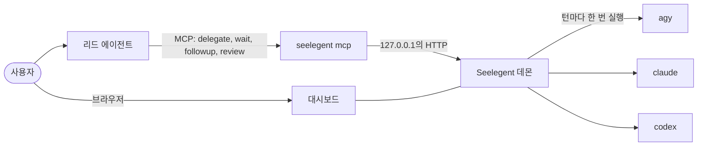

<div align="center">

<picture>
  <source media="(prefers-color-scheme: dark)" srcset="docs/media/logo-dark.svg">
  
</picture>

**리드 에이전트 하나가 계획하고 리뷰합니다. 코드는 여러분 계정에서 돌아가는 코딩 CLI가 씁니다.**

[설치](#설치)&nbsp;· [빠른 시작](#빠른-시작)&nbsp;· [사용 가이드](docs/usage.md)&nbsp;· [문서](docs/README.md)&nbsp;·
[기여하기](CONTRIBUTING.md)

[English](README.md)&nbsp;· [Tiếng Việt](README.vi.md)&nbsp;· [简⁠体⁠中⁠文](README.zh-CN.md)&nbsp;· [Español](README.es.md)&nbsp;·
**한⁠국⁠어**&nbsp;· [日⁠本⁠語](README.ja.md)&nbsp;· [Русский](README.ru.md)

[](LICENSE)
[](https://github.com/NovaSeele/Seelegent/releases/latest)
[](go.mod)
[](#요구-사항)
[](https://github.com/NovaSeele/Seelegent/actions/workflows/ci.yml)

</div>

<!-- Hero: at publish time, replace this block with the uploaded user-attachments video URL on its own line. -->
<p align="center">
  <a href="docs/media/hero.mp4"></a>
</p>

Seelegent는 하나의 리드 코딩 에이전트가 여러분 자신의 계정에서 돌아가는 워커 코딩 CLI에 작업을 맡길 수 있게 해 줍니다.
여러분은 리드(Claude Code, Codex, Antigravity, OpenCode 또는 다른 MCP 호스트)와만 대화합니다. 리드가 작업을 설계하고
브리프를 써서 MCP로 위임하면, Seelegent는 남은 할당량이 가장 많은 계정에서 이를 평범한 비대화형 CLI 호출(`agy`,
`claude`, `codex`)로 실행하고, 결과를 검사한 뒤 리뷰할 수 있도록 보고서를 리드에게 돌려줍니다. 구독이나 API 키가
여러 개 있고, 한 에이전트는 계획과 리뷰를, 나머지는 코드 작성을 맡기고 싶은 사람을 위한 도구입니다.

Seelegent는 프록시가 아니며, 여러 계정을 하나의 엔드포인트 뒤로 묶지도 않습니다. 모든 실행은 여러분이 소유한 계정의
격리된 프로필에서 이루어지는 일반 CLI 호출이며, 각 계정에는 해당 제공자의 약관이 그대로 적용됩니다.

## 기능

- **지금 쓰는 리드에서 바로 위임.** 리드는 MCP로 `delegate`, `wait`, `followup`, `review`를 호출하고, Seelegent는 각
  턴을 평범한 워커 CLI 호출 한 번으로 실행해 보고서를 돌려줍니다. → [MCP 도구](docs/mcp.md)
- **처리할 일이 먼저 보입니다.** **모니터링** 페이지는 질문이 있거나, 로그인이 필요하거나, 게이트에 실패했거나, 파일이
  위험한 작업을 맨 위에 올리고, 각각 무엇을 해야 하는지 알려 주는 배너를 붙입니다. →
  [작업이 막혔을 때](docs/getting-started.md#7-when-something-is-stuck)
- **모든 단계가 기록됩니다.** 작업마다 터미널, 트리, 그래프, 파일, Git 보기가 있어 대화, 모든 도구 호출, 턴과 시도,
  줄마다 리뷰 노트를 달 수 있는 diff를 보여 줍니다. → [작업 엔진](docs/task-engine.md)
- **계정은 여럿, 풀은 하나.** 별도 로그인, 이 컴퓨터의 로그인, API 키 중에서 우선순위, 실행 중인 작업 수, 남은
  할당량으로 계정을 고르고, 할당량이 바닥난 계정의 작업은 인수인계 정보와 함께 다른 계정으로 옮겨 갑니다. →
  [설정](docs/configuration.md)
- **실패한 작업은 게이트가 되돌려 보냅니다.** 보고서가 올 때마다 데몬이 테스트, lint, 빌드를 돌리고, 실패한 게이트는
  자동 수정 턴으로 워커에게 돌려보내며, **증거** 페이지는 Spec Kit 요구 사항 중 무엇이 증명되었는지 추적합니다. →
  [게이트, 레인, 증거](docs/gates.md)
- **커밋하지 않은 작업은 그대로 남습니다.** Git 보호가 작업을 날릴 수 있는 git 명령을 거부하고, 매 턴 전후의
  스냅샷으로 그 턴이 잃어버렸을 수 있는 파일을 복원할 수 있습니다. → [안전](docs/safety.md)
- **워커만이 아닌 팀.** 이름과 등급이 있는 멤버가 두 번째 의견을 주고, 어려운 결정 전에 회의를 하고, 같은 브리프를
  별도 worktree에서 2~5개 변형으로 겨루는 대회를 엽니다. → [팀](docs/team.md)
- **이슈에서 초안 pull request까지, 또는 일정대로.** GitHub 이슈를 자기 worktree와 브랜치를 가진 티켓으로 분류하고,
  여러분이나 리드가 요청하면 비밀 값 검사 뒤 초안 pull request를 열고, 저장한 위임을 일정에 따라 실행합니다. →
  [GitHub](docs/github.md) · [자동화](docs/automations.md)

### 실제 화면

미리 보기를 누르면 짧은 영상이 열립니다. 더 많은 영상은 [사용 가이드](docs/usage.md)에 있습니다.

<table>
  <tr>
    <td width="50%" align="center">
      <a href="docs/media/delegate.mp4"></a><br>
      <b>위임</b>
    </td>
    <td width="50%" align="center">
      <a href="docs/media/needs-you.mp4"></a><br>
      <b>처리할 일</b>
    </td>
  </tr>
  <tr>
    <td width="50%" align="center">
      <a href="docs/media/task-detail.mp4"></a><br>
      <b>작업 상세</b>
    </td>
    <td width="50%" align="center">
      <a href="docs/media/gates-proof.mp4"></a><br>
      <b>게이트와 증거</b>
    </td>
  </tr>
  <tr>
    <td width="50%" align="center">
      <a href="docs/media/git-guard.mp4"></a><br>
      <b>Git 보호와 복원</b>
    </td>
    <td width="50%" align="center">
      <a href="docs/media/team.mp4"></a><br>
      <b>팀</b>
    </td>
  </tr>
</table>

## 요구 사항

- **OS:** Windows 10 또는 11, Linux, macOS(x64 또는 ARM64). 가장 많이 테스트된 플랫폼은 Windows입니다.
- **Git.** 스냅샷, Git 보기, 대회, GitHub 티켓에 필요합니다.
- **워커 CLI 하나 이상**: Antigravity CLI(`agy`, Gemini 모델, 기본 백엔드), Claude Code(`claude`) 또는
  Codex(`codex`). `claude`와 `codex` 백엔드는 설정에서 켜기 전까지 꺼져 있습니다.
- **MCP를 지원하는 리드 호스트**: Claude Code, Claude Desktop, Codex CLI, OpenCode, Antigravity CLI 또는 앱,
  Gemini CLI, Cursor, Windsurf. MCP가 없는 호스트는 대신 `seelegent` 명령을 쓸 수 있습니다.
- 선택: GitHub 기능을 쓰려면 로그인한 GitHub CLI(`gh`).

## 설치

**Windows**(PowerShell):

```powershell
irm https://raw.githubusercontent.com/NovaSeele/Seelegent/main/scripts/install.ps1 | iex
```

**Linux와 macOS:**

```sh
curl -fsSL https://raw.githubusercontent.com/NovaSeele/Seelegent/main/scripts/install.sh | sh
```

설치 프로그램은 최신 릴리스를 내려받아 릴리스의 `checksums.txt`로 SHA-256을 확인하고, `seelegent`를 PATH에
넣고(Windows는 `%LOCALAPPDATA%\Programs\seelegent\bin`, 그 밖에는 `~/.local/bin`), 이전 버전의 데이터가 있으면
가져온 다음, 이 컴퓨터의 리드 호스트에 대해 `seelegent setup`을 실행합니다. 끝나면 새 터미널을 열고 리드 호스트를
다시 시작하세요. `--version`, `--install-dir`, `--no-setup`(sh)이나 `-Version`, `-InstallDir`, `-NoSetup`(PowerShell)
같은 옵션은 [docs/release.md](docs/release.md#installing)에 있습니다. 소스에서 빌드하려면
[CONTRIBUTING.md](CONTRIBUTING.md#development-setup)를 보세요.

## 빠른 시작

1. **설치 확인:** `seelegent doctor`는 설치 상태를 검사하고 실패한 항목을 고치는 법을 알려 줍니다. 새로 설치했다면
   `warn`은 정상이고, `fail`에는 고치는 방법이 함께 나옵니다.
2. **리드 호스트 연결:** 설치 프로그램이 이미 `seelegent setup`을 실행했습니다. 이 명령은 아는 아홉 가지 리드 호스트
   중 찾은 모든 호스트에 `seelegent` MCP 서버를 등록하고, Claude Code, Codex CLI, OpenCode, Antigravity CLI에는
   리드 스킬도 설치합니다. 새 호스트를 설치했다면 다시 실행하고
   (`--dry-run`으로 변경 내용을 먼저 보고, `--remove`로 되돌림) 호스트를 다시 시작하세요. →
   [설정 명령](docs/setup.md)
3. **계정 추가:** `seelegent ui`는 필요하면 데몬을 시작하고 http://127.0.0.1:47821/을 엽니다. **계정**에서
   **계정 추가**를 고르고 백엔드와 종류를 정합니다. 자체 로그인을 쓰는 계정이면 워커 CLI 자체의 로그인 절차가
   곧바로 브라우저나 터미널 창에서 시작되며(계정 카드의 **로그인**은 다시 시도할 때 씀), Seelegent는 비밀번호를
   절대 보지 않습니다.
4. **위임하기.** 프로젝트 폴더에서 리드에게 *"Seelegent로 회원 가입 폼에 입력 검증을 추가하고 diff를 리뷰해 줘."*
   같이 요청합니다. 리드는 `delegate`를 호출해 보고서를 기다리고, diff를 읽고 테스트를 실행한 뒤 `followup`을
   보내거나 `review`로 작업을 닫습니다. 터미널에서는:
   `seelegent delegate --cwd . --model fast "Describe this project in five lines"`.

[사용 가이드](docs/usage.md)(영어)는 일상 작업을 할 일별로 안내하고,
[docs/getting-started.md](docs/getting-started.md)(영어)는 첫 실행을 단계별로 자세히 설명합니다.

## 설정

설정은 대시보드의 **설정** 대화 상자와 `~/.seelegent/config.json`에 있습니다. 게이트 동시 실행 수, 메모리 임계값,
테스트 병렬도는 기본적으로 이 컴퓨터의 메모리와 CPU로 계산됩니다. **설정 › 리소스**에서 어느 값이든 직접 정하거나
다시 자동으로 돌릴 수 있습니다. → [설정 값](docs/configuration.md) · [리소스](docs/configuration.md#resources)

## 동작 방식



- **바이너리 하나.** `seelegent` 하나가 데몬, 명령줄, 리드 호스트가 실행하는 MCP 서버(`seelegent mcp`), 웹 대시보드를
  모두 맡습니다.
- **데몬**은 `127.0.0.1:47821`에서만 수신합니다. 계정을 고르고, 워커를 실행하고, 모든 단계를 기록하고, 검사를
  실행합니다. 재시작해도 작업이 끊기지 않으며, 실행 중인 워커는 다음 데몬이 이어받습니다.
- **워커**는 여러분이 이미 쓰는 CLI 그대로이며, 계정마다 자기 프로필 폴더가 있습니다. 작업 도중 계정의 할당량이
  바닥나면 그 계정은 할당량 창이 재설정될 때까지 쉬고, 작업은 인수인계 정보와 함께 다른 계정으로 옮겨 갑니다.
- **대시보드**(http://127.0.0.1:47821/)는 바이너리에 내장되어 인터넷에서 아무것도 불러오지 않습니다. 일곱 가지
  언어를 지원하며, **설정 › 언어**에서 따로 고르지 않으면 브라우저 언어를 따릅니다. `profiles`를 뺀 모든 MCP
  도구에는 `seelegent` 명령도 있습니다([docs/cli.md](docs/cli.md)).

작업이 거치는 과정과 MCP 도구 17개 전체 목록은 [사용 가이드](docs/usage.md#what-a-task-goes-through)(영어)에
있습니다.

## 안전

Git 보호는 커밋하지 않은 변경을 날릴 수 있는 git 명령을 거부하고, 매 턴 전후의 스냅샷으로 그 턴이 잃어버렸을 수
있는 것을 복원할 수 있으며, Seelegent는 티켓 브랜치를 푸시하기 전에 모든 파일을 검사합니다. 이것들은 보호 장치일
뿐 샌드박스가 아닙니다. 워커 CLI는 여러분의 사용자 권한으로 실행되므로 바뀐 내용은 꼭 리뷰하세요.
[docs/safety.md](docs/safety.md)를 보고, 보안 문제는 [SECURITY.md](SECURITY.md)에 따라 알려 주세요.

## 데이터와 개인 정보

모든 것이 여러분의 컴퓨터에서 실행됩니다. 데몬은 `127.0.0.1`에서만 수신하고, Seelegent는 원격 측정을 보내지 않으며
비밀번호를 묻지 않습니다. 데이터는 `~/.seelegent`에 있습니다(`SEELEGENT_HOME`으로 위치 변경). 무엇이 저장되고
무엇이 컴퓨터 밖으로 나가는지는 [사용 가이드](docs/usage.md#data-and-privacy)를 보세요.

## 업데이트와 제거

`seelegent update --apply`는 새 릴리스를 제자리에서 설치하고, `seelegent update --rollback`은 한 번 이전으로
되돌립니다. 바이너리를 지우기 전에 `seelegent setup --remove`로 호스트 등록을 되돌리세요. 전체 단계와 이전 Node
버전에서 옮겨 오는 방법: [사용 가이드](docs/usage.md#update-and-uninstall).

## 문제 해결

먼저 `seelegent doctor`를, 그다음 `seelegent status`를 실행하세요. 데몬 로그는 `~/.seelegent/logs/daemon.log`입니다.
**처리할 일**에 있는 작업은 배너에 할 일을 알려 줍니다. 더 보기: [사용 가이드](docs/usage.md#doctor-and-troubleshooting).

## 문서

문서는 영어로 되어 있습니다.

- [사용 가이드](docs/usage.md): 일상 작업을 할 일별로.
- [시작하기](docs/getting-started.md): 첫 실행을 단계별로.
- [문서 목록](docs/README.md): 설정 명령, 설정 값, 안전, GitHub, 자동화, 리드를 위한 참고 문서(MCP 도구, 게이트,
  팀), 명령줄, HTTP API, 작업 엔진, 기여자 가이드.

## 기여와 보안

기여를 환영합니다. [CONTRIBUTING.md](CONTRIBUTING.md)에 개발 환경, pull request가 통과해야 하는 검사, 커밋 규칙이
있습니다. 참여하는 모든 사람은 [행동 강령](CODE_OF_CONDUCT.md)을 따릅니다. 보안 문제는 공개 이슈가 아니라
[SECURITY.md](SECURITY.md)에 적힌 대로 비공개로 알려 주세요.

## 라이선스

Seelegent는 소스 공개(source-available) 소프트웨어이며
[Functional Source License 1.1, Apache 2.0 Future License (FSL-1.1-ALv2)](LICENSE)로 배포됩니다.

- 경쟁 용도가 아닌 한 어떤 목적으로든 사용, 복사, 수정, 공유할 수 있습니다. 회사 내부 사용, 비상업적 교육과 연구,
  이를 사용하는 사람에게 제공하는 전문 서비스도 포함됩니다.
- 경쟁 용도란 Seelegent를 상용 제품이나 서비스에 넣어 다른 사람에게 제공하는 것으로, 그 제품이나 서비스가
  Seelegent(또는 라이선스 제공자가 이를 이용해 제공하는 다른 제품이나 서비스)를 대체하거나, 같거나 실질적으로 비슷한
  기능을 제공하는 경우를 말합니다.
- 각 버전은 출시 2년 뒤 Apache License 2.0으로도 사용할 수 있게 됩니다.

정확한 조건은 [LICENSE](LICENSE) 파일에 있습니다. Seelegent와 함께 배포되는 제3자 저작물은
[THIRD_PARTY_NOTICES.md](THIRD_PARTY_NOTICES.md)에 나와 있습니다.
