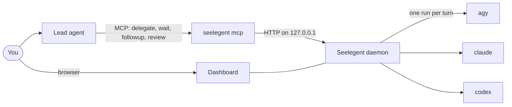

<div align="center">

<picture>
  <source media="(prefers-color-scheme: dark)" srcset="docs/media/logo-dark.svg">
  
</picture>

**One lead agent plans and reviews. Worker coding CLIs on your own accounts write the code.**

[Install](#install)&nbsp;· [Quick start](#quick-start)&nbsp;· [Usage guide](docs/usage.md)&nbsp;·
[Docs](docs/README.md)&nbsp;· [Contributing](CONTRIBUTING.md)

**English**&nbsp;· [Tiếng Việt](README.vi.md)&nbsp;· [简⁠体⁠中⁠文](README.zh-CN.md)&nbsp;· [Español](README.es.md)&nbsp;·
[한⁠국⁠어](README.ko.md)&nbsp;· [日⁠本⁠語](README.ja.md)&nbsp;· [Русский](README.ru.md)

[](LICENSE)
[](https://github.com/NovaSeele/Seelegent/releases/latest)
[](go.mod)
[](#requirements)
[](https://github.com/NovaSeele/Seelegent/actions/workflows/ci.yml)

</div>

<!-- Hero: at publish time, replace this block with the uploaded user-attachments video URL on its own line. -->
<p align="center">
  <a href="docs/media/hero.mp4"></a>
</p>

Seelegent lets one lead coding agent hand work to worker coding CLIs that run on your own accounts. You talk to the
lead (Claude Code, Codex, Antigravity, OpenCode or another MCP host); the lead designs the work, writes a brief and
delegates it over MCP; Seelegent runs it as a normal non-interactive CLI call (`agy`, `claude` or `codex`) on the
account with the most quota left, checks the result, and hands the report back for review. It is for people who
have several subscriptions or API keys and want one agent to plan and review while the others write the code.

Seelegent is not a proxy and does not pool accounts behind one endpoint. Every run is an ordinary CLI call on an
account you own, in its own isolated profile, and each provider's terms still apply to each account.

## Features

- **Delegate from the lead you already use.** The lead calls `delegate`, `wait`, `followup` and `review` over MCP,
  and Seelegent runs each turn as one ordinary worker CLI call and returns its report. → [MCP tools](docs/mcp.md)
- **See what needs you first.** The **Watch** page puts tasks with a question, a missing sign-in, a red gate or
  work at risk at the top, each with a banner that says what to do. →
  [When something is stuck](docs/getting-started.md#7-when-something-is-stuck)
- **Every step on record.** Each task has Terminal, Tree, Graph, Files and Git views: the conversation, every tool
  call, turns and attempts, and the diff with review notes on its lines. → [Task engine](docs/task-engine.md)
- **Many accounts, one pool.** Own sign-ins, this computer's sign-in or API keys are picked by priority, running
  tasks and quota left, and a task whose account runs out moves to another one with a handover. →
  [Configuration](docs/configuration.md)
- **Gates that send red work back.** After every report the daemon runs the tests, lint and build, returns a red
  gate to the worker as an automatic fix turn, and the **Proof** page tracks which Spec Kit requirements are
  proven. → [Gates, lanes and proof](docs/gates.md)
- **Your uncommitted work stays put.** The git guard refuses the git commands that can throw work away, and
  snapshots before and after every turn let you restore files a turn may have lost. → [Safety](docs/safety.md)
- **A team, not only workers.** Named members with ranks give second opinions, hold meetings before hard
  decisions, and run one brief as a contest of 2 to 5 variants in separate worktrees. → [Team](docs/team.md)
- **From issue to draft pull request, or on a schedule.** Triage GitHub issues into tickets with their own worktree
  and branch, open a draft pull request after a secret scan, and run saved delegations on a schedule. →
  [GitHub](docs/github.md) · [Automations](docs/automations.md)

### See it in action

Each preview links to a short video; the [usage guide](docs/usage.md) has more.

<table>
  <tr>
    <td width="50%" align="center">
      <a href="docs/media/delegate.mp4"></a><br>
      <b>Delegate</b>
    </td>
    <td width="50%" align="center">
      <a href="docs/media/needs-you.mp4"></a><br>
      <b>Needs you</b>
    </td>
  </tr>
  <tr>
    <td width="50%" align="center">
      <a href="docs/media/task-detail.mp4"></a><br>
      <b>Task detail</b>
    </td>
    <td width="50%" align="center">
      <a href="docs/media/gates-proof.mp4"></a><br>
      <b>Gates and proof</b>
    </td>
  </tr>
  <tr>
    <td width="50%" align="center">
      <a href="docs/media/git-guard.mp4"></a><br>
      <b>Git guard and restore</b>
    </td>
    <td width="50%" align="center">
      <a href="docs/media/team.mp4"></a><br>
      <b>Team</b>
    </td>
  </tr>
</table>

## Requirements

- **OS:** Windows 10 or 11, Linux or macOS, on x64 or ARM64. Windows is the most tested platform.
- **Git.** Seelegent needs it for snapshots, the Git view, contests and GitHub tickets.
- **At least one worker CLI**, installed: the Antigravity CLI (`agy`, Gemini models, the default backend), Claude
  Code (`claude`) or Codex (`codex`). The `claude` and `codex` backends are off until you turn them on in Settings.
- **A lead host** with MCP: Claude Code, Claude Desktop, Codex CLI, OpenCode, the Antigravity CLI or app, Gemini CLI,
  Cursor or Windsurf. A host without MCP can use the `seelegent` command instead.
- Optional: the GitHub CLI (`gh`), signed in, for the GitHub features.

## Install

**Windows** (PowerShell):

```powershell
irm https://raw.githubusercontent.com/NovaSeele/Seelegent/main/scripts/install.ps1 | iex
```

**Linux and macOS:**

```sh
curl -fsSL https://raw.githubusercontent.com/NovaSeele/Seelegent/main/scripts/install.sh | sh
```

The installer downloads the latest release, checks its SHA-256 against the release's `checksums.txt`, puts
`seelegent` on your PATH (`%LOCALAPPDATA%\Programs\seelegent\bin` on Windows, `~/.local/bin` elsewhere), imports the
old version's data if it finds any, and runs `seelegent setup` for the lead hosts on this machine. Open a new
terminal and restart your lead hosts afterwards. Options such as `--version`, `--install-dir` and `--no-setup` (sh)
or `-Version`, `-InstallDir` and `-NoSetup` (PowerShell) are in [docs/release.md](docs/release.md#installing). To
build from source, see [CONTRIBUTING.md](CONTRIBUTING.md#development-setup).

## Quick start

1. **Check the install:** `seelegent doctor` checks the install and says how to fix what fails. A `warn` is fine on
   a fresh install; a `fail` comes with a fix.
2. **Connect your lead hosts:** the installer already ran `seelegent setup`, which registers the `seelegent` MCP
   server and the lead skill with every lead host it finds, out of nine it knows. Run it again after installing a new
   host (`--dry-run` shows the changes first, `--remove` undoes them), then restart the host. →
   [Setup](docs/setup.md)
3. **Add an account:** `seelegent ui` starts the daemon if needed and opens http://127.0.0.1:47821/. On
   **Accounts**, choose **Add account**, pick the backend and the kind, then **Sign in**: the worker CLI's own
   sign-in runs, in your browser or a terminal window, and Seelegent never sees your password.
4. **Delegate.** In a project folder, ask your lead something like *"Use Seelegent to add input validation to the
   signup form, then review the diff."* The lead calls `delegate`, waits for the report, reads the diff, runs the
   tests, and then sends a `followup` or closes the task with `review`. From a terminal:
   `seelegent delegate --cwd . --model fast "Describe this project in five lines"`.

The [usage guide](docs/usage.md) covers everyday work task by task, and
[docs/getting-started.md](docs/getting-started.md) walks through the first run in detail.

## Configuration

Settings live in the dashboard's **Settings** dialog and in `~/.seelegent/config.json`. Gate concurrency, memory
thresholds and test parallelism are sized to this machine's memory and CPUs by default; set any of them, or go back
to auto, in **Settings › Resources**. → [Configuration](docs/configuration.md) · [Resources](docs/configuration.md#resources)

## How it works



- **One binary.** `seelegent` is the daemon, the command line, the MCP server the lead host starts (`seelegent
  mcp`) and the web dashboard, all in one file.
- **The daemon** listens on `127.0.0.1:47821` only. It picks an account, runs the worker, records every step, runs
  the checks and keeps going across restarts: running workers are picked up again by the next daemon.
- **Workers** are the worker CLIs you already use, each account in its own profile folder. When an account runs out
  of quota in the middle of a task, it rests until its window resets and the task moves to another account with a
  handover.
- **The dashboard** (http://127.0.0.1:47821/) is embedded in the binary and loads nothing from the internet. It
  comes in seven languages and follows your browser's language unless you pick one in **Settings › Language**.
  Every MCP tool except `profiles` also has a `seelegent` command ([docs/cli.md](docs/cli.md)).

The [usage guide](docs/usage.md#what-a-task-goes-through) explains what a task goes through and lists all 17 MCP tools.

## Safety

The git guard refuses the git commands that can throw away uncommitted work, snapshots before and after every turn
let you restore what a turn may have lost, and Seelegent scans every file before it pushes a ticket branch. These are
guards, not a sandbox: worker CLIs run as your user, so review what they changed. See
[docs/safety.md](docs/safety.md), and [SECURITY.md](SECURITY.md) to report a security problem.

## Data and privacy

Everything runs on your machine: the daemon listens on `127.0.0.1` only, Seelegent sends no telemetry, and it never
asks for passwords. Data lives in `~/.seelegent` (`SEELEGENT_HOME` moves it). What is stored there and what leaves the
machine: [usage guide](docs/usage.md#data-and-privacy).

## Update and uninstall

`seelegent update --apply` installs a newer release in place and `seelegent update --rollback` goes back once.
`seelegent setup --remove` undoes the host registration before you delete the binary. Every step, and moving from the
old Node version: [usage guide](docs/usage.md#update-and-uninstall).

## Troubleshooting

Run `seelegent doctor` first, then `seelegent status`; the daemon's log is `~/.seelegent/logs/daemon.log`. A task in
**Needs you** says on its banner what to do. More: [usage guide](docs/usage.md#doctor-and-troubleshooting).

## Documentation

- [Usage guide](docs/usage.md): everyday work, task by task.
- [Getting started](docs/getting-started.md): the first run, step by step.
- [Docs index](docs/README.md): setup, configuration, safety, GitHub, automations, the lead's reference (MCP tools,
  gates, team), the command line, the HTTP API, the task engine and the contributor guide.

## Contributing and security

Contributions are welcome: [CONTRIBUTING.md](CONTRIBUTING.md) covers the development setup, the checks a pull request
must pass and the commit style. Everyone taking part follows the [Code of Conduct](CODE_OF_CONDUCT.md). Please report
security problems privately, as [SECURITY.md](SECURITY.md) describes, not in a public issue.

## License

Seelegent is source-available under the
[Functional Source License 1.1, Apache 2.0 Future License (FSL-1.1-ALv2)](LICENSE).

- You may use, copy, change and share it for any purpose other than a competing use, including inside a company,
  for non-commercial education and research, and in professional services you provide to someone who uses it.
- A competing use is making Seelegent available to others in a commercial product or service that substitutes for
  it (or for another product or service the licensor offers with it), or that offers the same or substantially
  similar functionality.
- Two years after each version is made available, that version is also available under the Apache License 2.0.

The [LICENSE](LICENSE) file has the exact terms. Third-party works shipped with Seelegent are listed in
[THIRD_PARTY_NOTICES.md](THIRD_PARTY_NOTICES.md).
