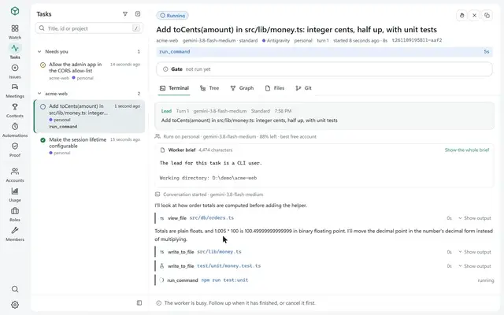
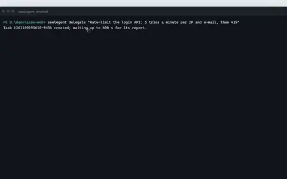
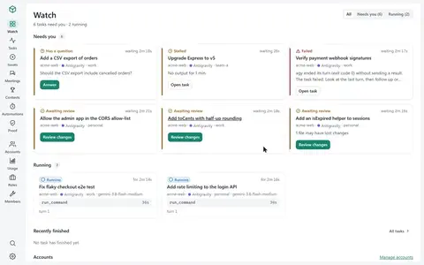
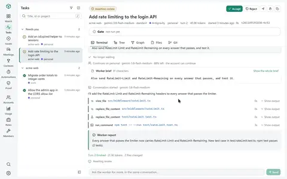
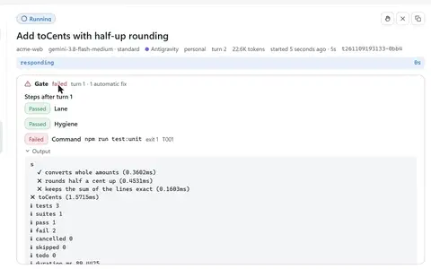
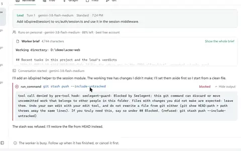
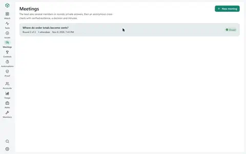

<div align="center">

<picture>
  <source media="(prefers-color-scheme: dark)" srcset="docs/media/logo-dark.svg">
  
</picture>

**Один ведущий агент планирует и проверяет. Код пишут CLI для программирования на ваших собственных аккаунтах.**

[Установка](#установка)&nbsp;· [Быстрый старт](#быстрый-старт)&nbsp;· [Руководство](docs/usage.md)&nbsp;·
[Документация](docs/README.md)&nbsp;· [Участие в разработке](CONTRIBUTING.md)

[English](README.md)&nbsp;· [Tiếng Việt](README.vi.md)&nbsp;· [简⁠体⁠中⁠文](README.zh-CN.md)&nbsp;· [Español](README.es.md)&nbsp;·
[한⁠국⁠어](README.ko.md)&nbsp;· [日⁠本⁠語](README.ja.md)&nbsp;· **Русский**

[](LICENSE)
[](https://github.com/NovaSeele/Seelegent/releases/latest)
[](go.mod)
[](#требования)
[](https://github.com/NovaSeele/Seelegent/actions/workflows/ci.yml)

</div>

<!-- Hero: at publish time, replace this block with the uploaded user-attachments video URL on its own line. -->
<p align="center">
  <a href="docs/media/hero.mp4"></a>
</p>

Seelegent позволяет одному ведущему агенту-программисту (lead) передавать работу исполнителям: CLI для
программирования, которые работают на ваших собственных аккаунтах. Вы общаетесь только с ведущим (Claude Code, Codex,
Antigravity, OpenCode или другой MCP-хост); он проектирует работу, пишет бриф и делегирует его через MCP, а Seelegent
выполняет задачу обычным неинтерактивным вызовом CLI (`agy`, `claude` или `codex`) на аккаунте с наибольшим остатком
квоты, проверяет результат и возвращает отчёт ведущему на ревью. Инструмент для тех, у кого несколько подписок или
API-ключей и кто хочет, чтобы один агент планировал и проверял, а остальные писали код.

Seelegent не прокси и не прячет аккаунты за общей точкой входа. Каждый запуск — это обычный вызов CLI на вашем
аккаунте, в его собственном изолированном профиле, и условия каждого провайдера по-прежнему действуют для каждого
аккаунта.

## Возможности

- **Делегируйте из того ведущего, которым уже пользуетесь.** Ведущий вызывает `delegate`, `wait`, `followup` и
  `review` через MCP, а Seelegent выполняет каждый ход одним обычным вызовом CLI исполнителя и возвращает отчёт. →
  [MCP-инструменты](docs/mcp.md)
- **Сначала то, что ждёт вас.** Страница **Обзор** поднимает наверх задачи с вопросом, без входа в аккаунт, с
  непройденным гейтом или с файлами под угрозой, и у каждой есть баннер с тем, что нужно сделать. →
  [Когда что-то застряло](docs/getting-started.md#7-when-something-is-stuck)
- **Каждый шаг записан.** У каждой задачи есть виды Терминал, Дерево, Граф, Файлы и Git: диалог, каждый вызов
  инструмента, ходы и попытки, а также diff с заметками ревью к строкам. → [Движок задач](docs/task-engine.md)
- **Много аккаунтов, один пул.** Свой вход, вход этого компьютера или API-ключи выбираются по приоритету, числу
  запущенных задач и остатку квоты, а задача, у аккаунта которой кончилась квота, переходит на другой аккаунт с
  передачей дел. → [Настройки](docs/configuration.md)
- **Гейты возвращают непройденную работу.** После каждого отчёта демон прогоняет тесты, линтер и сборку, возвращает
  непройденный гейт исполнителю как ход исправления, а страница **Аудит** показывает, какие требования Spec Kit
  доказаны. → [Гейты, дорожки и аудит](docs/gates.md)
- **Незакоммиченная работа остаётся на месте.** Защита Git отклоняет команды git, способные выбросить работу, а снимки
  до и после каждого хода позволяют восстановить файлы, которые ход мог потерять. → [Безопасность](docs/safety.md)
- **Команда, а не только исполнители.** Именованные участники с рангами дают второе мнение, проводят совещания перед
  трудными решениями и выполняют один бриф как конкурс из 2–5 вариантов в отдельных worktree. →
  [Команда](docs/team.md)
- **От issue до чернового pull request — или по расписанию.** Разбирайте issues GitHub в тикеты со своим worktree и
  веткой, открывайте черновой pull request после проверки на секреты, когда вы или ведущий об этом просите, и запускайте сохранённые делегирования по
  расписанию. → [GitHub](docs/github.md) · [Расписание](docs/automations.md)

### Как это выглядит

Каждое превью ведёт на короткое видео; больше — в [руководстве](docs/usage.md).

<table>
  <tr>
    <td width="50%" align="center">
      <a href="docs/media/delegate.mp4"></a><br>
      <b>Делегирование</b>
    </td>
    <td width="50%" align="center">
      <a href="docs/media/needs-you.mp4"></a><br>
      <b>Ждут вас</b>
    </td>
  </tr>
  <tr>
    <td width="50%" align="center">
      <a href="docs/media/task-detail.mp4"></a><br>
      <b>Задача в подробностях</b>
    </td>
    <td width="50%" align="center">
      <a href="docs/media/gates-proof.mp4"></a><br>
      <b>Гейты и аудит</b>
    </td>
  </tr>
  <tr>
    <td width="50%" align="center">
      <a href="docs/media/git-guard.mp4"></a><br>
      <b>Защита Git и восстановление</b>
    </td>
    <td width="50%" align="center">
      <a href="docs/media/team.mp4"></a><br>
      <b>Команда</b>
    </td>
  </tr>
</table>

## Требования

- **ОС:** Windows 10 или 11, Linux или macOS, x64 или ARM64. Лучше всего протестирована Windows.
- **Git.** Он нужен для снимков, вида Git, конкурсов и тикетов GitHub.
- **Хотя бы один CLI исполнителя**: Antigravity CLI (`agy`, модели Gemini, бэкенд по умолчанию), Claude Code
  (`claude`) или Codex (`codex`). Бэкенды `claude` и `codex` выключены, пока вы не включите их в настройках.
- **Хост ведущего** с поддержкой MCP: Claude Code, Claude Desktop, Codex CLI, OpenCode, Antigravity CLI или приложение
  Antigravity, Gemini CLI, Cursor или Windsurf. Хост без MCP может пользоваться командой `seelegent`.
- Необязательно: GitHub CLI (`gh`) с выполненным входом — для функций GitHub.

## Установка

**Windows** (PowerShell):

```powershell
irm https://raw.githubusercontent.com/NovaSeele/Seelegent/main/scripts/install.ps1 | iex
```

**Linux и macOS:**

```sh
curl -fsSL https://raw.githubusercontent.com/NovaSeele/Seelegent/main/scripts/install.sh | sh
```

Установщик скачивает последний релиз, сверяет его SHA-256 с файлом `checksums.txt` релиза, кладёт `seelegent` в PATH
(`%LOCALAPPDATA%\Programs\seelegent\bin` в Windows, `~/.local/bin` в остальных системах), импортирует данные старой
версии, если находит их, и запускает `seelegent setup` для хостов ведущего на этой машине. После этого откройте новый
терминал и перезапустите хосты ведущего. Параметры вроде `--version`, `--install-dir` и `--no-setup` (sh) или
`-Version`, `-InstallDir` и `-NoSetup` (PowerShell) описаны в [docs/release.md](docs/release.md#installing). Сборка
из исходников описана в [CONTRIBUTING.md](CONTRIBUTING.md#development-setup).

## Быстрый старт

1. **Проверьте установку:** `seelegent doctor` проверяет установку и подсказывает, как исправить то, что не прошло.
   `warn` на свежей установке — это нормально; у `fail` всегда есть подсказка, как исправить.
2. **Подключите хосты ведущего:** установщик уже запустил `seelegent setup`, который регистрирует MCP-сервер
   `seelegent` во всех найденных хостах ведущего из девяти, которые он знает, а в Claude Code, Codex CLI, OpenCode и
   Antigravity CLI ставит ещё и навык ведущего. Запустите его снова
   после установки нового хоста (`--dry-run` сначала показывает изменения, `--remove` отменяет их) и перезапустите
   хост. → [Настройка хостов](docs/setup.md)
3. **Добавьте аккаунт:** `seelegent ui` при необходимости запускает демон и открывает http://127.0.0.1:47821/. На
   странице **Аккаунты** нажмите **Добавить аккаунт**, выберите бэкенд и тип. Для аккаунта со своим входом сразу
   запускается собственная процедура входа CLI исполнителя — в браузере или в окне терминала (кнопка **Войти** на
   карточке — для повторной попытки), и Seelegent никогда не видит ваш пароль.
4. **Делегируйте.** В папке проекта попросите ведущего, например: *«С помощью Seelegent добавь проверку ввода в форму
   регистрации, а потом проверь diff»*. Ведущий вызывает `delegate`, ждёт отчёт, читает diff, запускает тесты, а затем
   отправляет `followup` или закрывает задачу через `review`. Из терминала:
   `seelegent delegate --cwd . --model fast "Describe this project in five lines"`.

[Руководство](docs/usage.md) (на английском) разбирает повседневную работу по задачам, а
[docs/getting-started.md](docs/getting-started.md) (на английском) подробно описывает первый запуск.

## Настройки

Настройки находятся в окне **Настройки** панели и в `~/.seelegent/config.json`. Число одновременных гейтов, пороги
памяти и параллельность тестов по умолчанию рассчитываются по памяти и процессорам этой машины; любое значение можно
задать вручную или вернуть к авто в **Настройки › Ресурсы**. →
[Настройки](docs/configuration.md) · [Ресурсы](docs/configuration.md#resources)

## Как это работает


- **Один бинарный файл.** `seelegent` — это и демон, и командная строка, и MCP-сервер, который запускает хост
  ведущего (`seelegent mcp`), и веб-панель.
- **Демон** слушает только `127.0.0.1:47821`. Он выбирает аккаунт, запускает исполнителя, записывает каждый шаг,
  выполняет проверки и переживает перезапуск: следующий демон подхватывает работающих исполнителей.
- **Исполнители** — это те же CLI, которыми вы уже пользуетесь, у каждого аккаунта своя папка профиля. Если у аккаунта
  посреди задачи кончается квота, он отдыхает до сброса окна, а задача переходит на другой аккаунт с передачей дел.
- **Панель** (http://127.0.0.1:47821/) встроена в бинарный файл и ничего не загружает из интернета. Она доступна на
  семи языках и следует языку браузера, если вы не выберете язык в **Настройки › Язык**. У каждого MCP-инструмента,
  кроме `profiles`, есть и команда `seelegent` ([docs/cli.md](docs/cli.md)).

Через что проходит задача и полный список из 17 MCP-инструментов — в
[руководстве](docs/usage.md#what-a-task-goes-through) (на английском).

## Безопасность

Защита Git отклоняет команды git, способные выбросить незакоммиченную работу, снимки до и после каждого хода позволяют
восстановить то, что ход мог потерять, а перед отправкой ветки тикета Seelegent проверяет каждый файл. Это защитные
барьеры, а не песочница: CLI исполнителей работают от вашего пользователя, поэтому проверяйте, что они изменили. См.
[docs/safety.md](docs/safety.md), а о проблемах безопасности сообщайте по [SECURITY.md](SECURITY.md).

## Данные и конфиденциальность

Всё работает на вашем компьютере: демон слушает только `127.0.0.1`, Seelegent не отправляет телеметрию и никогда не
спрашивает пароли. Данные лежат в `~/.seelegent` (`SEELEGENT_HOME` переносит их). Что там хранится и что покидает
компьютер — в [руководстве](docs/usage.md#data-and-privacy).

## Обновление и удаление

`seelegent update --apply` устанавливает новый релиз на место текущего, а `seelegent update --rollback` один раз
возвращает предыдущую версию. Перед удалением бинарного файла отмените регистрацию в хостах через
`seelegent setup --remove`. Все шаги и переход со старой версии на Node — в
[руководстве](docs/usage.md#update-and-uninstall).

## Устранение неполадок

Сначала запустите `seelegent doctor`, затем `seelegent status`; лог демона — `~/.seelegent/logs/daemon.log`. Задача
в разделе **Ждут вас** пишет на баннере, что нужно сделать. Подробнее — в
[руководстве](docs/usage.md#doctor-and-troubleshooting).

## Документация

Документация написана на английском.

- [Руководство](docs/usage.md): повседневная работа, задача за задачей.
- [Начало работы](docs/getting-started.md): первый запуск, шаг за шагом.
- [Оглавление документации](docs/README.md): настройка хостов, параметры, безопасность, GitHub, расписание, справка для
  ведущего (MCP-инструменты, гейты, команда), командная строка, HTTP API, движок задач и руководство для участников
  разработки.

## Участие и безопасность

Мы рады вашему участию: в [CONTRIBUTING.md](CONTRIBUTING.md) описаны среда разработки, проверки, которые должен пройти
pull request, и правила коммитов. Все участники следуют [Кодексу поведения](CODE_OF_CONDUCT.md). О проблемах
безопасности сообщайте приватно, как описано в [SECURITY.md](SECURITY.md), а не в публичном issue.

## Лицензия

Исходный код Seelegent доступен для просмотра (source-available) по лицензии
[Functional Source License 1.1, Apache 2.0 Future License (FSL-1.1-ALv2)](LICENSE).

- Вы можете использовать, копировать, изменять и распространять его для любых целей, кроме конкурирующего
  использования, — в том числе внутри компании, для некоммерческого обучения и исследований и в профессиональных
  услугах, которые вы оказываете его пользователям.
- Конкурирующее использование — это предоставление Seelegent другим в коммерческом продукте или сервисе, который
  заменяет его (или другой продукт либо сервис, предлагаемый лицензиаром с его помощью) или предлагает такую же либо
  существенно похожую функциональность.
- Через два года после выпуска каждой версии она также становится доступна по лицензии Apache License 2.0.

Точные условия — в файле [LICENSE](LICENSE). Сторонние работы, поставляемые вместе с Seelegent, перечислены в
[THIRD_PARTY_NOTICES.md](THIRD_PARTY_NOTICES.md).
