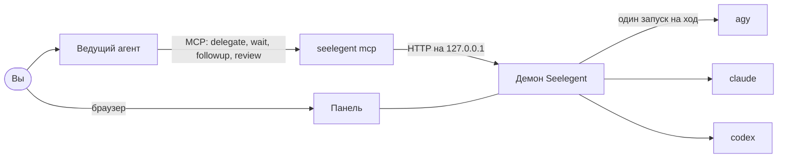

# Seelegent

[English](README.md) · [Tiếng Việt](README.vi.md) · [简体中文](README.zh-CN.md) · [Español](README.es.md) ·
[한국어](README.ko.md) · [日本語](README.ja.md) · **Русский**

Seelegent позволяет одному ведущему агенту-программисту (lead) передавать работу исполнителям: CLI для
программирования, которые работают на ваших собственных аккаунтах. Вы общаетесь только с ведущим (Claude Code, Codex,
Antigravity, OpenCode или другой MCP-хост); он проектирует работу, пишет бриф и делегирует его через MCP, а Seelegent
выполняет задачу обычным неинтерактивным вызовом CLI (`agy`, `claude` или `codex`) на аккаунте с наибольшим остатком
квоты, проверяет результат и возвращает отчёт ведущему на ревью. Инструмент для тех, у кого несколько подписок или
API-ключей и кто хочет, чтобы один агент планировал и проверял, а остальные писали код.

Seelegent не прокси и не прячет аккаунты за общей точкой входа. Каждый запуск — это обычный вызов CLI на вашем
аккаунте, в его собственном изолированном профиле, и условия каждого провайдера по-прежнему действуют для каждого
аккаунта.

## Как это работает



- **Один бинарный файл.** `seelegent` — это и демон, и командная строка, и MCP-сервер, который запускает хост
  ведущего (`seelegent mcp`), и веб-панель.
- **Демон** слушает только `127.0.0.1:47821`. Он выбирает аккаунт, запускает исполнителя, записывает каждый шаг,
  выполняет проверки и переживает перезапуск: следующий демон подхватывает работающих исполнителей.
- **Исполнители** — это те же CLI, которыми вы уже пользуетесь, у каждого аккаунта своя папка профиля. Если у аккаунта
  посреди задачи кончается квота, он отдыхает до сброса окна, а задача переходит на другой аккаунт с передачей дел.
- **Панель** (http://127.0.0.1:47821/) показывает, что ждёт вас, что выполняется, шаги и diff каждой задачи, аккаунты
  и квоты, а также всё, о чём рассказано ниже.

## Требования

- **ОС:** Windows 10 или 11, Linux или macOS, x64 или ARM64. Лучше всего протестирована Windows.
- **Git.** Он нужен для снимков, вида Git, конкурсов и тикетов GitHub.
- **Хотя бы один CLI исполнителя**: Antigravity CLI (`agy`, модели Gemini, бэкенд по умолчанию), Claude Code
  (`claude`) или Codex (`codex`). Бэкенды `claude` и `codex` выключены, пока вы не включите их в настройках.
- **Хост ведущего** с поддержкой MCP: Claude Code, Claude Desktop, Codex CLI, OpenCode, Antigravity CLI или приложение
  Antigravity, Gemini CLI, Cursor или Windsurf. Хост без MCP может пользоваться командой `seelegent`.
- Необязательно: GitHub CLI (`gh`) с выполненным входом — для функций GitHub.

## Установка

Windows (PowerShell):

```powershell
irm https://raw.githubusercontent.com/NovaSeele/Seelegent/main/scripts/install.ps1 | iex
```

Linux и macOS:

```sh
curl -fsSL https://raw.githubusercontent.com/NovaSeele/Seelegent/main/scripts/install.sh | sh
```

Установщик скачивает последний релиз, сверяет его SHA-256 с файлом `checksums.txt` релиза, кладёт `seelegent` в PATH
(`%LOCALAPPDATA%\Programs\seelegent\bin` в Windows, `~/.local/bin` в остальных системах), импортирует данные старой
версии, если находит их, и запускает `seelegent setup` для хостов ведущего на этой машине. После этого откройте новый
терминал и перезапустите хосты ведущего. Параметры вроде `--version`, `--install-dir` и `--no-setup` описаны в
[docs/release.md](docs/release.md#installing).

## Первые шаги

1. **Проверьте установку:** `seelegent doctor`.
2. **Откройте панель:** `seelegent ui` при необходимости запускает демон и открывает http://127.0.0.1:47821/.
3. **Добавьте аккаунт** на странице **Аккаунты**: выберите бэкенд и тип (свой вход, вход этого компьютера или API-ключ
   через провайдера). Вход выполняет собственная процедура входа CLI исполнителя — в браузере или в окне терминала;
   Seelegent никогда не видит ваш пароль. Чтобы пользоваться `claude` или `codex`, сначала включите бэкенд и задайте
   модели уровней в **Настройки › Бэкенды**.
4. **Подключите хост ведущего** (установщик уже это сделал): `seelegent setup` добавляет MCP-сервер `seelegent` во все
   найденные хосты ведущего и ставит навык (skill) ведущего туда, где хост читает навыки. `--host claude,codex`
   выбирает хосты, `--dry-run` сначала показывает изменения, `--remove` отменяет их. Перезапустите хост.
5. **Делегируйте.** В папке проекта попросите ведущего, например: *«С помощью Seelegent добавь проверку ввода в форму
   регистрации, а потом проверь diff»*. Ведущий вызывает `delegate`, ждёт отчёт, читает diff, запускает тесты, а затем
   отправляет `followup` или закрывает задачу через `review`. Из терминала:
   `seelegent delegate --cwd . --model fast "Describe this project in five lines"`.

Подробное пошаговое руководство — в [docs/getting-started.md](docs/getting-started.md) (на английском).

## Возможности

**Исполнители и аккаунты.** Три бэкенда (`agy`, `claude`, `codex`) и три типа аккаунтов: изолированный профиль со
своим входом, вход, уже выполненный на этом компьютере, или API-ключ провайдера (Anthropic, DeepSeek, Moonshot Kimi,
Z.ai GLM, OpenRouter, OpenAI, Groq, локальный Ollama или свой адрес). Пул читает окна квоты каждого аккаунта и
предпочитает аккаунты с более высоким приоритетом, меньшим числом запущенных задач и большим остатком квоты. Уровни
моделей `fast`, `standard`, `strong` и `max` сопоставляются с реальными моделями каждого бэкенда. См.
[настройки](docs/configuration.md).

**Задачи.** Задача — это диалог: `delegate`, затем сколько угодно `followup`, затем `review` с `accepted` или
`rejected`. Задачи идут параллельно, могут ждать друг друга (`after`), в каждый бриф попадают память проекта и
история ревью, задачу можно выполнять в роли исполнителя (правила, стиль отчёта, навыки, уровень по умолчанию) и
передавать ей папку функции и номера задач Spec Kit вместо всей спецификации. Задачи, которые зависли, зациклились или
задали вопрос, будят ведущего раньше времени, а задачи, которые ждут вас (нужен вход, не осталось аккаунтов),
поднимаются наверх панели. Задачу можно **перехватить** в консоли и потом вернуть исполнителю. См.
[движок задач](docs/task-engine.md).

**Гейты, дорожки и аудит.** После каждого отчёта исполнителя демон прогоняет гейт задачи: команды ведущего, строки
`Gate:` из спецификации или найденные в репозитории команды тестов, линтера и сборки, принципы проекта, проверку
синтаксиса и гигиены. **Не пройденный** гейт возвращается исполнителю как автоматический ход исправления (по умолчанию
2 раза), и только потом будит ведущего. Дорожки перечисляют файлы, которые задаче можно менять, чтобы параллельные
исполнители не мешали друг другу. По желанию после пройденного гейта можно запросить второе мнение — проверку только на
чтение. Страница **Аудит** показывает, какие требования Spec Kit доказаны, и запускает регрессионные прогоны. См.
[гейты](docs/gates.md).

**Команда.** Участники — это именованные исполнители с бэкендом, моделью или уровнем, ролью и рангом (исполнитель,
старший, равный: `worker`, `senior`, `peer`). Можно попросить старшего или равного дать второе мнение о завершённой
задаче (возражение равного блокирует принятие, пока ведущий на него не ответит), оставлять заметки ревью к строкам diff
и отправлять их одним доп. заданием, собрать совещание до шести участников перед трудным решением (равный может
зафиксировать особое мнение) или устроить конкурс: один бриф выполняется в 2–5 вариантах в отдельных worktree, и
победитель применяется к вашим файлам. Хуки событий запускают ваши shell-команды, когда задачи начинаются,
завершаются или ждут вас. См. [описание команды](docs/team.md).

**GitHub.** Подключите репозиторий, синхронизируйте его открытые issues во входящие (или добавьте локальные) и
разберите каждый в тикет: свой worktree и ветка, над которыми работают одна или несколько задач. Когда работа
принята, вы или ведущий просите Seelegent сделать коммит, отправить ветку тикета и открыть черновой pull request;
дальше он следит за проверками CI и может запустить задачу, чтобы починить упавшие. Если в `gh` выполнен вход,
используется `gh`, иначе токен, сохранённый в панели, иначе ручной режим со ссылкой для сравнения. См.
[GitHub](docs/github.md).

**Расписание.** Сохранённые делегирования по расписанию (каждый час, каждый день, по будням, раз в неделю или cron, в
выбранном часовом поясе) с командой предварительной проверки и правилами квоты: при нехватке квоты запуск
пропускается, а дополнительный запуск может израсходовать недельную квоту, которая скоро сбросится неиспользованной.
См. [автоматизации](docs/automations.md).

**Панель.** Страницы Обзор, Задачи, Issues, Совещания, Конкурсы, Расписание, Аудит, Аккаунты, Расход, Роли и
Участники, а также окно настроек с поиском. У каждой задачи есть виды Терминал, Дерево, Граф, Файлы и Git. 26 цветовых
тем, семь языков интерфейса, палитра команд (`Ctrl+K`, `Cmd+K` в macOS) и сочетания клавиш. Панель встроена в
бинарный файл и ничего не загружает из интернета.

**Командная строка.** У каждого MCP-инструмента есть команда, и каждая команда принимает `--json`: см.
`seelegent --help` и [docs/cli.md](docs/cli.md).

### MCP-инструменты ведущего

| Инструмент | Что делает |
|---|---|
| `delegate` | Запускает задачу (или конкурс) и ждёт отчёт исполнителя. |
| `wait` | Ждёт одну или несколько задач; `any: true` возвращается после первой. |
| `followup` | Отправляет задаче следующее указание или исправления. |
| `review` | Закрывает задачу как `accepted` или `rejected`, с заметками. |
| `cancel` | Останавливает выполняемую задачу или задачу в очереди. |
| `task` | Отчёт задачи и последние шаги исполнителя. |
| `status` | Аккаунты и квоты, активные задачи, бэкенды. |
| `memory` | Заметки проекта, которые попадают в каждый бриф. |
| `profiles` | Роли исполнителей: правила, стиль отчёта, навыки, уровень по умолчанию. |
| `proof` | Матрица требований, регрессионные прогоны, занятые дорожки, статистика. |
| `members` | Участники отдела. |
| `consult` | Второе мнение старшего или равного о завершённой задаче. |
| `notes` | Заметки ревью к diff задачи, отправляемые одним доп. заданием. |
| `meeting` | Структурированное совещание участников перед решением. |
| `contest` | Ход конкурса, выбор победителя. |
| `issues` | Issues GitHub в тикеты, worktree и черновые pull request. |
| `automations` | Делегирования по расписанию. |

`seelegent setup` также устанавливает навык ведущего, который учит его этому циклу; `seelegent skill` выводит его.
Подробности: [docs/mcp.md](docs/mcp.md).

## Безопасность

Исполнители работают в папках, где у вас и у других исполнителей лежат незакоммиченные изменения. Seelegent защищает
их в несколько слоёв; ни один из них сам по себе не проваливает задачу — они сообщают ведущему и панели, что
произошло. См. [docs/safety.md](docs/safety.md).

- **Защита Git.** Исполнители не могут выполнять команды git, способные выбросить незакоммиченную работу или
  переписать историю: `reset`, `restore`, `stash`, `checkout` и `switch` (создавать новую ветку можно), `clean`,
  `rebase`, `merge`, `pull`, `push`, `commit -a` и `--amend` и другие — в том числе внутри `bash -c`, PowerShell,
  конвейеров в оболочку и псевдонимов git. Ведущий может снять защиту на один ход через `allow_git`.
- **Снимки.** До и после каждого хода Seelegent записывает незакоммиченные файлы репозитория, не трогая ваш index,
  stash и ref. Файлы, которые ход мог потерять, отмечаются как *под угрозой*; их можно вернуть кнопкой
  **Восстановить** в панели или командой `seelegent restore`.
- **Проверки после хода.** Смена окончаний строк или BOM, лишние файлы, запись за пределы проекта и пересечения с
  другими задачами отображаются в задаче.
- **Чего исполнитель не может.** Исполнитель не может вызвать сам Seelegent (не может создавать, менять задачи или
  проводить их ревью), не может включить автоматизацию и не может сохранить токен GitHub. Последние два действия
  доступны только вам, в панели.
- **Перед отправкой.** Seelegent отправляет только один собственный коммит, никогда не коммиты исполнителя, и только
  после проверки каждого добавляемого файла: файлы `.env`, ключи и сертификаты, файлы с учётными данными, токены в
  содержимом файлов, имена устройств Windows вроде `nul` и файлы больше 5 МБ запрещают отправку, обойти это нельзя.
  Он никогда не делает force-push, не сливает ветки и не закрывает issues.
- **Автоматизации создаются выключенными.** Каждая автоматизация создаётся выключенной. Она запустится, только когда вы
  подтвердите в панели, что именно она делает, а любое изменение того, что или когда она запускает, снова её
  выключает.

Это защитные барьеры, а не песочница: CLI исполнителей работают от вашего пользователя. Проверяйте, что они изменили.

## Данные и конфиденциальность

- Всё работает на вашем компьютере. Демон слушает только `127.0.0.1`. Телеметрии нет.
- Данные лежат в `~/.seelegent` (переменная `SEELEGENT_HOME` переносит их): `config.json` (настройки),
  `seelegent.db` (задачи, аккаунты, расход, команда, тикеты, автоматизации), `profiles/` (изолированный профиль для
  каждого аккаунта), `snapshots/`, `worktrees/` и `logs/`. См. [docs/configuration.md](docs/configuration.md).
- Seelegent никогда не спрашивает пароли. Каждый CLI исполнителя входит своим способом и хранит токены в профиле
  аккаунта. API-ключи и токен GitHub хранятся каждый в своём файле: в Windows они зашифрованы DPAPI, в других системах
  это открытый текст, доступный только владельцу (0600); панель показывает только последние четыре символа, а в логах
  секреты скрываются.
- Что покидает компьютер: CLI исполнителей обращаются к своим провайдерам (в этом и состоит работа), квота читается
  через CLI (а для входов Claude — с конечной точки использования Anthropic, по входу самого аккаунта), аккаунты с
  API-ключом обращаются к настроенному вами провайдеру, а к GitHub обращения идут только по подключённым вами
  репозиториям (синхронизация, опрос issues и pull request каждые 10 минут — отключается `githubPollMinutes: 0`, и
  отправки, pull request и комментарии, о которых попросили вы или ведущий), а также из установщиков и
  `seelegent update`.

## Обновление и удаление

`seelegent update` сообщает, есть ли новый релиз; `seelegent update --apply` устанавливает его на место текущего
(с проверкой по `checksums.txt`, перезапуском демона и обновлением хостов ведущего), а `seelegent update --rollback`
один раз возвращает предыдущую версию. База данных никогда не мигрирует назад, поэтому релиз старше ваших данных будет
отклонён. См. [docs/release.md](docs/release.md#updating).

Удаление:

1. `seelegent stop`, затем `seelegent setup --remove` (удаляет записи MCP, навык ведущего и хук).
2. Удалите бинарный файл и сохранённый рядом `seelegent.exe.previous` (`seelegent.previous`):
   `%LOCALAPPDATA%\Programs\seelegent\bin\` в Windows, `~/.local/bin/seelegent*` в остальных системах. Уберите эту папку
   из PATH (пользовательская переменная `Path` в Windows, строка `export PATH=...`, которую установщик добавил в профиль
   оболочки, в остальных системах).
3. При желании удалите `~/.seelegent`. Там хранятся профили аккаунтов (с их входами), ключи, задачи и история.

## Переход со старой версии

Старая версия на Node хранила данные в той же папке. При первой установке установщик запускает `seelegent migrate`,
который импортирует настройки, провайдеров, аккаунты с профилями и API-ключами, память проектов и историю ревью,
роли, участников, хуки, записи совещаний и автоматизации (все выключены и ждут повторного подтверждения). Задачи,
заметки ревью, конкурсы, записи аудита, история расхода и папка GitHub не импортируются: подключите репозитории и
сохраните токен заново. Старая папка никогда не изменяется; в Windows старый запускатель остаётся доступен как
`seelegent-node`. Остановите старый демон перед установкой и запустите `seelegent migrate --dry-run`, чтобы увидеть,
что будет импортировано. См. [docs/setup.md](docs/setup.md#seelegent-migrate).

## Устранение неполадок

- `seelegent doctor` проверяет папку данных, настройки, базу данных, демон, git, каждый включённый CLI исполнителя,
  аккаунты и PATH и подсказывает, как исправить то, что не прошло. Он ничего не меняет.
- `seelegent status` показывает демон, аккаунты с квотами и задачи, которые ждут вас; `seelegent restart`
  перезапускает демон. Его лог — `~/.seelegent/logs/daemon.log`.
- `seelegent setup --dry-run` показывает, что зарегистрировано в каждом хосте ведущего. После setup или обновления
  перезапустите хост.
- Сообщение «Seelegent is not available inside a Seelegent worker.» означает, что исполнитель попытался вызвать
  Seelegent; это запрещено намеренно.
- Задача в разделе **Ждут вас** объясняет причину на баннере: ответьте на её вопрос, выполните вход в аккаунт,
  восстановите файлы под угрозой или дайте доп. задание, если гейт не пройден.

## Документация

Все документы (на английском) перечислены в [docs/README.md](docs/README.md): руководство по началу работы для
пользователей, справка для ведущего, командная строка, HTTP API и руководство для участников разработки.

## Лицензия

Исходный код Seelegent доступен для просмотра (source-available) по лицензии
[Functional Source License 1.1, Apache 2.0 Future License (FSL-1.1-ALv2)](LICENSE).

- Вы можете использовать, изменять и распространять его для любых целей, в том числе внутри компании, а также создавать
  с его помощью и продавать собственные продукты.
- Нельзя предлагать другим сам Seelegent или его изменённую копию как коммерческий продукт или сервис, который с ним
  конкурирует.
- Через два года после выпуска каждой версии она также становится доступна по лицензии Apache License 2.0.

Точные условия — в файле [LICENSE](LICENSE). Сторонние работы, поставляемые вместе с Seelegent, перечислены в
[THIRD_PARTY_NOTICES.md](THIRD_PARTY_NOTICES.md).
