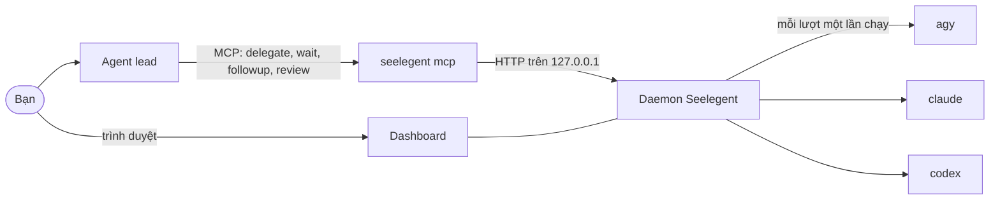

<div align="center">


**Một agent lead lên kế hoạch và review. Các CLI lập trình chạy trên chính tài khoản của bạn viết code.**

[Cài đặt](#cài-đặt) · [Bắt đầu nhanh](#bắt-đầu-nhanh) · [Hướng dẫn sử dụng](docs/usage.md) · [Tài liệu](docs/README.md) ·
[Đóng góp](CONTRIBUTING.md)

[English](README.md) · **Tiếng Việt** · [简体中文](README.zh-CN.md) · [Español](README.es.md) ·
[한국어](README.ko.md) · [日本語](README.ja.md) · [Русский](README.ru.md)

[](LICENSE)
[](https://github.com/NovaSeele/Seelegent/releases/latest)
[](go.mod)
[](#yêu-cầu)
[](https://github.com/NovaSeele/Seelegent/actions/workflows/ci.yml)

</div>

<p align="center">
  <a href="docs/media/hero.mp4"></a>
</p>

Seelegent cho một agent lead giao việc cho các worker là những CLI lập trình chạy trên chính tài khoản của bạn. Bạn
trò chuyện với lead (Claude Code, Codex, Antigravity, OpenCode hoặc một host MCP khác); lead thiết kế công việc, viết
brief và giao qua MCP; Seelegent chạy việc đó bằng một lần gọi CLI không tương tác bình thường (`agy`, `claude` hoặc
`codex`) trên tài khoản còn nhiều hạn mức (quota) nhất, kiểm tra kết quả rồi trả báo cáo về để lead review. Seelegent
dành cho người có nhiều gói thuê bao hoặc khóa API và muốn một agent lo lên kế hoạch và review, còn các agent khác
viết code.

Seelegent không phải proxy và không gộp các tài khoản sau một đầu mối chung. Mỗi lượt chạy là một lần gọi CLI bình
thường trên một tài khoản bạn sở hữu, trong profile cô lập của riêng nó, và điều khoản của từng nhà cung cấp vẫn áp
dụng cho từng tài khoản.

## Tính năng

- **Giao việc từ chính lead bạn đang dùng.** Lead gọi `delegate`, `wait`, `followup` và `review` qua MCP, còn
  Seelegent chạy mỗi lượt bằng một lần gọi CLI worker bình thường rồi trả báo cáo về. → [Công cụ MCP](docs/mcp.md)
- **Thấy ngay việc cần bạn.** Trang **Theo dõi** đưa lên đầu các tác vụ đang có câu hỏi, thiếu đăng nhập, không đạt
  cổng kiểm tra hoặc có tệp có nguy cơ mất, mỗi tác vụ kèm một banner nói rõ cần làm gì. →
  [Khi tác vụ bị kẹt](docs/getting-started.md#7-when-something-is-stuck)
- **Mọi bước đều được ghi lại.** Mỗi tác vụ có các chế độ xem Terminal, Cây, Đồ thị, Tệp và Git: cuộc hội thoại, từng
  lần gọi công cụ, các lượt và lần thử, cùng diff với ghi chú review trên từng dòng. →
  [Bộ máy tác vụ](docs/task-engine.md)
- **Nhiều tài khoản, một nhóm chung.** Đăng nhập riêng, đăng nhập của máy này hoặc khóa API được chọn theo độ ưu tiên,
  số tác vụ đang chạy và hạn mức còn lại; tác vụ có tài khoản hết hạn mức sẽ chuyển sang tài khoản khác kèm bản bàn
  giao. → [Cấu hình](docs/configuration.md)
- **Cổng kiểm tra trả việc chưa đạt về.** Sau mỗi báo cáo, daemon chạy test, lint và build, trả cổng không đạt về
  worker thành một lượt tự sửa, và trang **Bằng chứng** theo dõi yêu cầu nào của Spec Kit đã được chứng minh. →
  [Cổng kiểm tra, làn và bằng chứng](docs/gates.md)
- **Thay đổi chưa commit của bạn được giữ nguyên.** Bảo vệ Git từ chối các lệnh git có thể xóa công việc, và bản chụp
  trước, sau mỗi lượt cho phép khôi phục các tệp mà lượt đó có thể đã làm mất. → [An toàn](docs/safety.md)
- **Một đội ngũ, không chỉ là worker.** Các thành viên có tên và cấp bậc cho ý kiến thứ hai, họp trước những quyết định
  khó, và chạy một brief thành cuộc thi 2 đến 5 phiên bản trong các worktree riêng. → [Làm việc nhóm](docs/team.md)
- **Từ issue tới pull request nháp, hoặc theo lịch.** Phân loại issue GitHub thành ticket có worktree và nhánh riêng,
  mở pull request nháp sau khi quét bí mật, và chạy các lần giao việc đã lưu theo lịch. →
  [GitHub](docs/github.md) · [Tự động](docs/automations.md)
- **Vừa với máy của bạn.** Số cổng kiểm tra chạy cùng lúc, các ngưỡng bộ nhớ và mức song song khi test được tính từ bộ
  nhớ và CPU của máy này; bạn có thể đặt riêng từng giá trị, hoặc quay về tự động, trong **Cài đặt › Tài nguyên**. →
  [Tài nguyên](docs/configuration.md#resources)
- **Một lệnh để thiết lập, một lệnh để kiểm tra.** `seelegent setup` đăng ký MCP server và skill của lead với chín host
  lead, còn `seelegent doctor` kiểm tra bản cài và chỉ cách sửa những gì hỏng. →
  [Thiết lập](docs/setup.md) · [doctor](docs/cli.md#doctor)

### Xem thực tế

Mỗi ảnh xem trước dẫn tới một video ngắn.

<table>
  <tr>
    <td width="50%" align="center">
      <a href="docs/media/delegate.mp4"></a><br>
      <b>Giao việc</b>
    </td>
    <td width="50%" align="center">
      <a href="docs/media/needs-you.mp4"></a><br>
      <b>Cần bạn</b>
    </td>
  </tr>
  <tr>
    <td width="50%" align="center">
      <a href="docs/media/task-detail.mp4"></a><br>
      <b>Chi tiết tác vụ</b>
    </td>
    <td width="50%" align="center">
      <a href="docs/media/accounts.mp4"></a><br>
      <b>Tài khoản và hạn mức</b>
    </td>
  </tr>
  <tr>
    <td width="50%" align="center">
      <a href="docs/media/gates-proof.mp4"></a><br>
      <b>Cổng kiểm tra và bằng chứng</b>
    </td>
    <td width="50%" align="center">
      <a href="docs/media/git-guard.mp4"></a><br>
      <b>Bảo vệ Git và khôi phục</b>
    </td>
  </tr>
  <tr>
    <td width="50%" align="center">
      <a href="docs/media/team.mp4"></a><br>
      <b>Làm việc nhóm</b>
    </td>
    <td width="50%" align="center">
      <a href="docs/media/github-automations.mp4"></a><br>
      <b>GitHub và tự động</b>
    </td>
  </tr>
  <tr>
    <td width="50%" align="center">
      <a href="docs/media/resources.mp4"></a><br>
      <b>Tài nguyên</b>
    </td>
    <td width="50%" align="center">
      <a href="docs/media/setup-doctor.mp4"></a><br>
      <b>Thiết lập và doctor</b>
    </td>
  </tr>
</table>

## Yêu cầu

- **Hệ điều hành:** Windows 10 hoặc 11, Linux hoặc macOS, chip x64 hoặc ARM64. Windows là nền tảng được kiểm thử
  nhiều nhất.
- **Git.** Seelegent cần git cho bản chụp (snapshot), chế độ xem Git, cuộc thi và ticket GitHub.
- **Ít nhất một CLI worker** đã cài: Antigravity CLI (`agy`, model Gemini, backend mặc định), Claude Code (`claude`)
  hoặc Codex (`codex`). Backend `claude` và `codex` tắt sẵn cho tới khi bạn bật trong Cài đặt.
- **Một host cho lead** có MCP: Claude Code, Claude Desktop, Codex CLI, OpenCode, Antigravity CLI hoặc ứng dụng
  Antigravity, Gemini CLI, Cursor hoặc Windsurf. Host không có MCP có thể dùng lệnh `seelegent` thay thế.
- Không bắt buộc: GitHub CLI (`gh`) đã đăng nhập, cho các tính năng GitHub.

## Cài đặt

**Windows** (PowerShell):

```powershell
irm https://raw.githubusercontent.com/NovaSeele/Seelegent/main/scripts/install.ps1 | iex
```

**Linux và macOS:**

```sh
curl -fsSL https://raw.githubusercontent.com/NovaSeele/Seelegent/main/scripts/install.sh | sh
```

Trình cài đặt tải bản phát hành mới nhất, đối chiếu SHA-256 với `checksums.txt` của bản phát hành, đặt `seelegent`
vào PATH (`%LOCALAPPDATA%\Programs\seelegent\bin` trên Windows, `~/.local/bin` trên hệ khác), nhập dữ liệu của phiên
bản cũ nếu có, rồi chạy `seelegent setup` cho các host lead trên máy. Sau đó hãy mở terminal mới và khởi động lại
các host lead. Các tùy chọn như `--version`, `--install-dir` và `--no-setup` (sh) hay `-Version`, `-InstallDir` và
`-NoSetup` (PowerShell) có trong [docs/release.md](docs/release.md#installing). Muốn tự build từ mã nguồn, xem
[CONTRIBUTING.md](CONTRIBUTING.md#development-setup).

## Bắt đầu nhanh

1. **Kiểm tra bản cài:** `seelegent doctor`. Mục `warn` là bình thường với bản cài mới; mục `fail` luôn kèm cách sửa.
2. **Kết nối host lead:** trình cài đặt đã chạy `seelegent setup`, lệnh này thêm MCP server `seelegent` vào mọi host
   lead tìm thấy và cài skill cho lead. Chạy lại sau khi cài thêm host mới (`--dry-run` cho xem trước thay đổi,
   `--remove` gỡ bỏ), rồi khởi động lại host.
3. **Thêm tài khoản:** `seelegent ui` khởi động daemon nếu cần và mở http://127.0.0.1:47821/. Ở trang **Tài khoản**,
   chọn **Thêm tài khoản**, chọn backend và loại tài khoản, rồi **Đăng nhập**: luồng đăng nhập của chính CLI worker sẽ
   chạy, trong trình duyệt hoặc một cửa sổ terminal, và Seelegent không bao giờ thấy mật khẩu của bạn.
4. **Giao việc.** Trong một thư mục dự án, nhờ lead kiểu như *"Dùng Seelegent để thêm kiểm tra dữ liệu nhập cho form
   đăng ký, rồi review diff."* Lead gọi `delegate`, chờ báo cáo, đọc diff, chạy test, rồi gửi `followup` hoặc đóng
   tác vụ bằng `review`. Từ terminal:
   `seelegent delegate --cwd . --model fast "Describe this project in five lines"`.

[Hướng dẫn sử dụng](docs/usage.md) (tiếng Anh) đi qua công việc hằng ngày theo từng việc, còn
[docs/getting-started.md](docs/getting-started.md) (tiếng Anh) hướng dẫn chi tiết lần chạy đầu tiên.

## Cách hoạt động



- **Một tệp duy nhất.** `seelegent` vừa là daemon, vừa là dòng lệnh, vừa là MCP server mà host của lead khởi động
  (`seelegent mcp`), vừa là dashboard web.
- **Daemon** chỉ lắng nghe trên `127.0.0.1:47821`. Nó chọn tài khoản, chạy worker, ghi lại từng bước, chạy các bước
  kiểm tra và không bỏ dở việc khi khởi động lại: daemon mới nhận lại các worker đang chạy.
- **Worker** là chính các CLI bạn đang dùng, mỗi tài khoản một thư mục profile riêng. Khi một tài khoản hết hạn mức
  giữa chừng, nó được nghỉ tới khi khung hạn mức đặt lại, còn tác vụ chuyển sang tài khoản khác kèm bản bàn giao.
- **Dashboard** (http://127.0.0.1:47821/) có các trang Theo dõi, Tiến trình, Issue, Họp, Cuộc thi, Tự động, Bằng
  chứng, Tài khoản, Sử dụng, Vai trò và Thành viên, cùng hộp thoại Cài đặt có tìm kiếm. Nó có 26 giao diện màu, bảy
  ngôn ngữ, bảng lệnh (`Ctrl+K`, `Cmd+K` trên macOS) và phím tắt, được nhúng sẵn trong tệp chạy và không tải gì từ
  internet.
- **Dòng lệnh.** Mỗi công cụ MCP, trừ `profiles`, đều có lệnh tương ứng (vai trò worker được sửa ở trang **Vai trò**
  và qua công cụ `profiles`), và mọi lệnh đều nhận `--json`: xem `seelegent --help` và [docs/cli.md](docs/cli.md).

### Một tác vụ đi qua những gì

**Tài khoản.** Ba backend (`agy`, `claude`, `codex`) và ba loại tài khoản: profile cô lập với đăng nhập riêng, đăng
nhập sẵn có của máy này (chỉ `agy`), hoặc khóa API của một nhà cung cấp (chỉ `claude` và `codex`: Anthropic,
DeepSeek, Moonshot Kimi, Z.ai GLM, OpenRouter, OpenAI, Groq, Ollama chạy local, hoặc endpoint tùy chỉnh). Nhóm tài
khoản đọc các khung hạn mức của từng tài khoản và ưu tiên tài khoản có độ ưu tiên cao hơn, ít tác vụ đang chạy hơn
và còn nhiều hạn mức hơn. Các mức model `fast`, `standard`, `strong` và `max` ánh xạ sang model thật của từng
backend.

**Tác vụ.** Mỗi tác vụ là một cuộc hội thoại: `delegate`, rồi `followup` bao nhiêu lần tùy ý, rồi `review` với
`accepted` hoặc `rejected`. Các tác vụ chạy song song, có thể chờ nhau (`after`), mọi brief đều kèm bộ nhớ dự án và
lịch sử review, có thể chạy theo một vai trò worker (luật, phong cách báo cáo, skill, mức mặc định), và có thể nhận
thư mục tính năng cùng mã task của Spec Kit thay vì cả bản spec. Tác vụ đứng im, lặp vòng hoặc đặt câu hỏi sẽ đánh
thức lead sớm; tác vụ cần bạn (cần đăng nhập, hết tài khoản) được đưa lên đầu dashboard. Bạn có thể **Tự làm tiếp**
một tác vụ trong console rồi trả lại cho worker.

**Cổng kiểm tra, làn và bằng chứng.** Sau mỗi báo cáo của worker, daemon chạy cổng kiểm tra của tác vụ: lệnh của lead,
các dòng `Gate:` của spec hoặc lệnh test, lint, build tự dò trong kho, nguyên tắc dự án, kiểm tra cú pháp và vệ sinh
mã. Cổng không đạt sẽ quay về worker thành một lượt tự sửa (mặc định 2 lượt) trước khi lead được đánh thức. Làn liệt
kê các tệp một tác vụ được sửa, để các worker chạy song song không giẫm lên tệp của nhau. Có thể bật thêm một lượt
duyệt lần hai chỉ đọc khi cổng đã đạt.

**Nhóm, GitHub và tự động.** Thành viên là các worker có tên, kèm backend, model hoặc mức, vai trò và cấp bậc
(`worker`, `senior`, `peer`); phản đối của một thành viên ngang hàng khi được hỏi ý kiến sẽ chặn việc chấp nhận cho
tới khi lead trả lời. Hook sự kiện chạy lệnh shell của bạn khi có sự kiện của tác vụ, tài khoản hay daemon. Issue của
một kho đã kết nối trở thành ticket; khi công việc được chấp nhận, Seelegent commit, push nhánh của ticket, mở pull
request nháp và theo dõi các check CI. Seelegent dùng `gh` nếu đã đăng nhập, nếu không thì dùng token bạn lưu trong
dashboard, nếu không nữa thì chế độ thủ công với đường dẫn so sánh. Tự động chạy theo lịch (mỗi giờ, mỗi ngày, ngày
làm việc, mỗi tuần hoặc cron, theo múi giờ), kèm lệnh kiểm tra trước và quy tắc hạn mức.

### Công cụ MCP cho lead

| Công cụ | Chức năng |
|---|---|
| `delegate` | Tạo tác vụ (hoặc cuộc thi) và chờ báo cáo của worker. |
| `wait` | Chờ một hay nhiều tác vụ; `any: true` trả về ngay khi tác vụ đầu tiên xong. |
| `followup` | Gửi chỉ dẫn tiếp theo hoặc yêu cầu sửa cho một tác vụ. |
| `review` | Đóng tác vụ với `accepted` hoặc `rejected`, kèm ghi chú. |
| `cancel` | Dừng tác vụ đang chạy hoặc đang xếp hàng. |
| `task` | Báo cáo của tác vụ và các bước gần đây của worker. |
| `status` | Tài khoản và hạn mức, tác vụ đang chạy, backend. |
| `memory` | Ghi chú theo dự án, được đưa vào mọi brief. |
| `profiles` | Vai trò worker: luật, phong cách báo cáo, skill, mức mặc định. |
| `proof` | Ma trận yêu cầu, chạy hồi quy, làn đang giữ, thống kê. |
| `members` | Các thành viên. |
| `consult` | Ý kiến thứ hai về một tác vụ đã xong, từ thành viên cố vấn hoặc ngang hàng. |
| `notes` | Ghi chú review trên diff của tác vụ, gửi thành một lần giao thêm. |
| `meeting` | Cuộc họp có cấu trúc giữa các thành viên trước một quyết định. |
| `contest` | Theo dõi cuộc thi, chọn bản thắng. |
| `issues` | Biến issue GitHub thành ticket, worktree và pull request nháp. |
| `automations` | Các lần giao việc theo lịch. |

`seelegent setup` cũng cài skill cho lead, dạy lead vòng làm việc này; `seelegent skill` in skill đó ra. Chi tiết:
[docs/mcp.md](docs/mcp.md).

## An toàn

Worker làm việc trong những thư mục mà bạn và các worker khác đang có thay đổi chưa commit. Seelegent bảo vệ chúng
theo nhiều lớp; không lớp nào tự đánh trượt tác vụ, chúng báo cho lead và dashboard biết chuyện gì đã xảy ra. Xem
[docs/safety.md](docs/safety.md).

- **Bảo vệ Git.** Worker không chạy được các lệnh git có thể xóa thay đổi chưa commit hoặc viết lại lịch sử: `reset`,
  `restore`, `stash`, `checkout` (trừ `checkout -b` để tạo nhánh), `switch`, `clean`, `rebase`, `merge`, `pull`,
  `push`, `commit -a` và `--amend`, cùng nhiều lệnh khác, kể cả khi nằm trong `bash -c`, PowerShell, lệnh pipe vào
  shell hay alias của git. Lead có thể tạm gỡ bảo vệ cho một lượt bằng `allow_git`.
- **Bản chụp.** Trước và sau mỗi lượt, Seelegent ghi lại các tệp chưa commit của kho mà không đụng tới index, stash
  hay ref của bạn. Tệp mà lượt đó có thể đã làm mất sẽ hiện là *có nguy cơ mất*, kèm nút khôi phục trong dashboard
  và lệnh `seelegent restore`.
- **Kiểm tra sau lượt.** Đổi kiểu xuống dòng, đổi BOM, tệp rác, ghi ra ngoài dự án và chồng lấn với tác vụ khác đều
  được báo trên tác vụ.
- **Những gì worker không làm được.** Worker không gọi được Seelegent (không tạo, sửa hay review tác vụ), không bật
  được tự động và không lưu được token GitHub. Chỉ bạn, trong dashboard, làm được hai việc sau cùng.
- **Trước khi push.** Seelegent push một commit của chính nó, không bao giờ push commit của worker, và chỉ sau khi đã
  quét mọi tệp sẽ thêm vào: tệp `.env`, khóa và chứng chỉ, tệp thông tin đăng nhập, token nằm trong nội dung tệp, tên
  thiết bị Windows như `nul` và tệp lớn hơn 5 MB đều khiến việc push bị từ chối, không có cách bỏ qua. Seelegent không
  bao giờ force-push, merge hay đóng issue.
- **Tự động khởi đầu ở trạng thái tắt.** Mọi tự động được tạo ra đều tắt. Nó chỉ chạy sau khi bạn xác nhận đúng những
  gì nó sẽ làm trong dashboard, và bất kỳ thay đổi nào về việc nó chạy gì hoặc khi nào đều tắt nó lại.

Đây là các lớp bảo vệ, không phải sandbox: CLI worker chạy dưới tài khoản người dùng của bạn. Hãy review những gì
chúng đã sửa. Để báo một vấn đề bảo mật, xem [SECURITY.md](SECURITY.md).

## Dữ liệu và quyền riêng tư

- Mọi thứ chạy trên máy bạn. Daemon chỉ lắng nghe trên `127.0.0.1`. Bản thân Seelegent không gửi telemetry; các CLI
  worker theo cài đặt riêng của chúng.
- Dữ liệu nằm ở `~/.seelegent` (đặt `SEELEGENT_HOME` để đổi chỗ): `config.json` (cài đặt), `seelegent.db` (tác vụ,
  tài khoản, mức sử dụng, nhóm, ticket, tự động), `profiles/` (mỗi tài khoản một profile cô lập, kèm khóa API của
  nó), `github/` (token), `snapshots/`, `contests/` (diff đã lưu của cuộc thi), `worktrees/` (chỉ cho cuộc thi và
  ticket), `run/` và `logs/`. Xem [docs/configuration.md](docs/configuration.md).
- Seelegent không bao giờ hỏi mật khẩu. Mỗi CLI worker đăng nhập bằng luồng riêng của nó và giữ token trong profile
  của tài khoản. Khóa API và token GitHub mỗi thứ nằm trong một tệp riêng, được mã hóa bằng DPAPI trên Windows và là
  văn bản thường chỉ chủ sở hữu đọc được (0600) trên hệ khác; dashboard chỉ hiện bốn ký tự cuối, và log che mọi bí
  mật.
- Những gì rời khỏi máy: CLI worker nói chuyện với nhà cung cấp của chính nó (đó là công việc), hạn mức được đọc qua
  các CLI (và với tài khoản Claude đăng nhập, qua endpoint usage của Anthropic bằng chính đăng nhập của tài khoản đó),
  tài khoản khóa API gọi nhà cung cấp bạn cấu hình, và GitHub chỉ được gọi cho những kho bạn kết nối (đồng bộ, kiểm
  tra issue và pull request mỗi 10 phút, tắt được bằng `githubPollMinutes: 0`, cùng các lần push, pull request và
  bình luận do bạn hoặc lead yêu cầu) và để kiểm tra đăng nhập GitHub của bạn khi bạn mở trang **Issue**, ngoài ra
  là trình cài đặt và `seelegent update`.

## Cập nhật và gỡ cài đặt

`seelegent update` cho biết có bản mới hay không; `seelegent update --apply` cài đè tại chỗ (đối chiếu
`checksums.txt`, khởi động lại daemon, làm mới các host lead) và `seelegent update --rollback` quay về bản trước một
lần. Cơ sở dữ liệu không bao giờ bị migrate ngược, nên bản phát hành cũ hơn dữ liệu của bạn sẽ bị từ chối. Xem
[docs/release.md](docs/release.md#updating).

Để gỡ cài đặt:

1. `seelegent stop`, rồi `seelegent setup --remove` (gỡ các mục MCP, skill của lead và hook).
2. Xóa tệp chạy cùng bản `seelegent.exe.previous` (`seelegent.previous`) được giữ bên cạnh:
   `%LOCALAPPDATA%\Programs\seelegent\bin\` trên Windows, `~/.local/bin/seelegent*` trên hệ khác. Gỡ thư mục đó khỏi
   PATH (biến `Path` của người dùng trên Windows, dòng `export PATH=...` mà trình cài đặt đã thêm vào profile của shell
   trên hệ khác).
3. Nếu muốn, xóa `~/.seelegent`. Thư mục này chứa profile tài khoản (kèm thông tin đăng nhập), khóa, tác vụ và lịch
   sử.

### Chuyển từ phiên bản cũ

Phiên bản Node cũ lưu dữ liệu ở cùng thư mục. Ở lần cài đầu tiên, trình cài đặt chạy `seelegent migrate` để nhập cài
đặt, nhà cung cấp, tài khoản kèm profile và khóa API, bộ nhớ dự án và lịch sử review, vai trò, thành viên, hook, biên
bản họp và các tự động (mọi tự động đều tắt, chờ bạn xác nhận lại). Tác vụ, ghi chú review, cuộc thi, bản ghi bằng
chứng, lịch sử sử dụng và thư mục GitHub không được nhập: hãy kết nối lại các kho và lưu lại token. Thư mục cũ không
bao giờ bị sửa. Trên Windows, nếu lệnh khởi chạy cũ nằm trong thư mục cài đặt, nó được giữ lại dưới tên
`seelegent-node`. Hãy dừng daemon cũ trước khi cài, và chạy `seelegent migrate --dry-run` để xem trước những gì sẽ
được nhập. Xem [docs/setup.md](docs/setup.md#seelegent-migrate).

## Xử lý sự cố

- `seelegent doctor` kiểm tra thư mục dữ liệu, cài đặt, cơ sở dữ liệu, daemon, git, từng CLI worker đang bật, tài
  khoản, PATH và bộ nhớ trống so với các ngưỡng tài nguyên, và chỉ cách sửa những gì hỏng. Lệnh này không thay đổi
  gì, ngoài một lần thử ghi trong thư mục dữ liệu (`.doctor-write-test`, được xóa ngay sau đó).
- `seelegent status` cho thấy daemon, tài khoản và hạn mức, và các tác vụ cần bạn; `seelegent restart` khởi động lại
  daemon. Log của daemon là `~/.seelegent/logs/daemon.log`.
- `seelegent setup --dry-run` cho thấy những gì đã đăng ký với từng host lead. Khởi động lại host sau khi setup hoặc
  cập nhật.
- Thông báo "Seelegent is not available inside a Seelegent worker." nghĩa là một worker đã cố gọi Seelegent; việc này
  bị từ chối có chủ đích.
- Một tác vụ nằm ở mục **Cần bạn** cho biết lý do trên banner: trả lời câu hỏi của nó, đăng nhập một tài khoản, khôi
  phục các tệp có nguy cơ mất, hoặc giao thêm khi cổng kiểm tra không đạt.

## Tài liệu

Tài liệu viết bằng tiếng Anh.

- [Hướng dẫn sử dụng](docs/usage.md): công việc hằng ngày, theo từng việc.
- [Bắt đầu](docs/getting-started.md): lần chạy đầu tiên, từng bước một.
- [Mục lục tài liệu](docs/README.md): thiết lập, cấu hình, an toàn, GitHub, tự động, tài liệu cho lead (công cụ MCP,
  cổng kiểm tra, làm việc nhóm), dòng lệnh, HTTP API, bộ máy tác vụ và hướng dẫn cho người đóng góp.

## Đóng góp và bảo mật

Mọi đóng góp đều được chào đón: [CONTRIBUTING.md](CONTRIBUTING.md) mô tả cách dựng môi trường phát triển, các bước
kiểm tra mà một pull request phải qua và quy ước commit. Mọi người tham gia đều tuân theo
[Quy tắc ứng xử](CODE_OF_CONDUCT.md). Hãy báo vấn đề bảo mật một cách riêng tư như [SECURITY.md](SECURITY.md) mô tả,
không mở issue công khai.

## Giấy phép

Seelegent công khai mã nguồn (source-available) theo giấy phép
[Functional Source License 1.1, Apache 2.0 Future License (FSL-1.1-ALv2)](LICENSE).

- Bạn được dùng, sao chép, sửa và chia sẻ cho mọi mục đích không phải sử dụng cạnh tranh, kể cả trong công ty, cho
  giáo dục và nghiên cứu phi thương mại, và trong dịch vụ chuyên môn bạn cung cấp cho người dùng nó.
- Sử dụng cạnh tranh là đưa Seelegent tới người khác trong một sản phẩm hay dịch vụ thương mại thay thế cho nó (hoặc
  cho một sản phẩm, dịch vụ khác mà bên cấp phép cung cấp cùng nó), hoặc có chức năng giống hay gần giống nó.
- Hai năm sau khi mỗi phiên bản được phát hành, phiên bản đó cũng được cấp phép theo Apache License 2.0.

Tệp [LICENSE](LICENSE) có điều khoản chính xác. Các thành phần bên thứ ba đi kèm Seelegent được liệt kê trong
[THIRD_PARTY_NOTICES.md](THIRD_PARTY_NOTICES.md).
