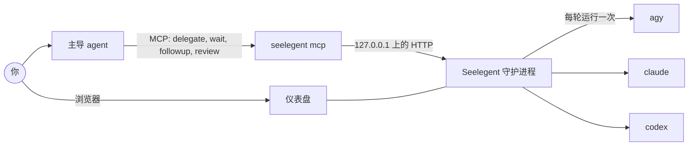

# Seelegent

[English](README.md) · [Tiếng Việt](README.vi.md) · **简体中文** · [Español](README.es.md) ·
[한국어](README.ko.md) · [日本語](README.ja.md) · [Русский](README.ru.md)

Seelegent 让一个主导编程 agent（lead）把工作交给在你自己账号上运行的 worker 编程 CLI。你只和 lead 对话（Claude
Code、Codex、Antigravity、OpenCode 或其他 MCP 宿主）；lead 设计工作、撰写任务说明（brief），通过 MCP 委派出去；
Seelegent 在剩余配额最多的账号上，以一次普通的非交互 CLI 调用（`agy`、`claude` 或 `codex`）执行它，检查结果，再把报告
交回给 lead 审阅。它适合手里有多个订阅或 API 密钥、希望由一个 agent 负责规划和审阅、其他 agent 负责写代码的人。

Seelegent 不是代理，也不会把多个账号聚合到同一个入口后面。每次运行都是在你自己拥有的账号上、在该账号独立的
profile 中进行的普通 CLI 调用，每个账号仍须遵守对应服务商的条款。

## 工作原理



- **单个二进制文件。** `seelegent` 同时是守护进程、命令行、lead 宿主启动的 MCP 服务器（`seelegent mcp`）和网页仪表盘。
- **守护进程**只监听 `127.0.0.1:47821`。它选择账号、运行 worker、记录每一步、执行检查，并且重启后不会中断：下一个
  守护进程会重新接管仍在运行的 worker。
- **Worker** 就是你已经在用的 CLI，每个账号一个独立的 profile 文件夹。账号在任务中途用完配额时，会休息到配额窗口
  重置，任务则带着交接信息转到另一个账号。
- **仪表盘**（http://127.0.0.1:47821/）显示需要你处理的事、正在运行的任务、每个任务的步骤和 diff、账号与配额，以及
  下文提到的所有功能。

## 运行要求

- **操作系统：** Windows 10 或 11、Linux 或 macOS，x64 或 ARM64。Windows 是测试最充分的平台。
- **Git。** 快照、Git 视图、竞赛和 GitHub 工单都需要它。
- **至少一个 worker CLI**：Antigravity CLI（`agy`，Gemini 模型，默认后端）、Claude Code（`claude`）或 Codex
  （`codex`）。`claude` 和 `codex` 后端默认关闭，需在设置中开启。
- **一个支持 MCP 的 lead 宿主**：Claude Code、Claude Desktop、Codex CLI、OpenCode、Antigravity CLI 或 Antigravity
  应用、Gemini CLI、Cursor 或 Windsurf。不支持 MCP 的宿主可以改用 `seelegent` 命令。
- 可选：已登录的 GitHub CLI（`gh`），用于 GitHub 相关功能。

## 安装

Windows（PowerShell）：

```powershell
irm https://raw.githubusercontent.com/NovaSeele/Seelegent/main/scripts/install.ps1 | iex
```

Linux 和 macOS：

```sh
curl -fsSL https://raw.githubusercontent.com/NovaSeele/Seelegent/main/scripts/install.sh | sh
```

安装脚本会下载最新版本，用该版本的 `checksums.txt` 校验 SHA-256，把 `seelegent` 放入 PATH（Windows 上是
`%LOCALAPPDATA%\Programs\seelegent\bin`，其他系统是 `~/.local/bin`），如果发现旧版本的数据就导入，然后为本机的
lead 宿主运行 `seelegent setup`。完成后请打开新的终端并重启 lead 宿主。`--version`、`--install-dir`、`--no-setup`
等选项见 [docs/release.md](docs/release.md#installing)。

## 快速上手

1. **检查安装：** `seelegent doctor`。
2. **打开仪表盘：** `seelegent ui` 会在需要时启动守护进程，并打开 http://127.0.0.1:47821/。
3. 在 **账号** 页面 **添加账号**：选择后端和类型（独立登录、本机的登录，或通过 API 提供方使用 API 密钥）。登录时运行
   的是 worker CLI 自己的登录流程，在浏览器或终端窗口中完成；Seelegent 永远看不到你的密码。要使用 `claude` 或
   `codex`，请先在 **设置 › 后端** 中开启该后端并为各档位设置模型。
4. **连接 lead 宿主**（安装脚本已经做过）：`seelegent setup` 会把 `seelegent` MCP 服务器添加到找到的每个 lead 宿主，
   并在支持 skill 的宿主中安装 lead skill。`--host claude,codex` 指定宿主，`--dry-run` 先预览改动，`--remove` 撤销。
   然后重启宿主。
5. **委派工作。** 在项目文件夹中对 lead 说类似这样的话：*“用 Seelegent 给注册表单加上输入校验，然后审阅 diff。”*
   lead 会调用 `delegate`，等待报告，阅读 diff，运行测试，然后发送 `followup` 或用 `review` 结束任务。在终端中：
   `seelegent delegate --cwd . --model fast "Describe this project in five lines"`。

[docs/getting-started.md](docs/getting-started.md)（英文）详细讲解每一步。

## 功能

**Worker 与账号。** 三种后端（`agy`、`claude`、`codex`）和三种账号：带独立登录的隔离 profile、本机已有的登录，或某个
提供方的 API 密钥（Anthropic、DeepSeek、Moonshot Kimi、Z.ai GLM、OpenRouter、OpenAI、Groq、本地 Ollama，或自定义
端点）。账号池读取每个账号的配额窗口，优先选择优先级更高、运行中任务更少、剩余配额更多的账号。模型档位 `fast`、
`standard`、`strong` 和 `max` 按后端映射到实际模型。见 [配置](docs/configuration.md)。

**任务。** 一个任务就是一段对话：先 `delegate`，再按需多次 `followup`，最后用 `review` 给出 `accepted` 或
`rejected`。任务可以并行运行，可以互相等待（`after`），每份 brief 都附带项目记忆和审阅历史，可以按某个 worker 角色
运行（规则、输出风格、技能、默认档位），也可以只传 Spec Kit 的功能文件夹和任务编号，而不必传整份 spec。停滞、
陷入循环或提出问题的任务会提前唤醒 lead；需要你处理的任务（需要登录、没有可用账号）会排在仪表盘最前面。你还可以在
控制台中 **接管** 任务，之后再交还给 worker。见 [任务引擎](docs/task-engine.md)。

**关卡、通道与证据。** worker 每次报告后，守护进程都会运行任务的关卡：lead 给的命令、spec 中的 `Gate:` 行或在仓库中
检测到的测试、lint、构建命令，以及项目准则、语法检查和卫生检查。关卡 **未通过** 时，会作为自动修复轮次退回给
worker（默认 2 次），之后才唤醒 lead。通道列出任务可以修改的文件，让并行的 worker 互不踩踏。可选的二次审查会在关卡
通过后以只读方式再审一遍。**证据** 页面显示哪些 Spec Kit 需求已被证明，并可执行回归运行。见 [关卡](docs/gates.md)。

**团队。** 成员是有名字的 worker，带有后端、模型或档位、角色和级别（工人、资深、同级：`worker`、`senior`、`peer`）。
你可以请资深或同级成员对已完成的任务给出第二意见（同级成员的反对意见在 lead 答复之前会阻止接受），在 diff 的行上
留下审阅备注并作为一次追加要求统一发送，在做艰难决定前召集最多六名成员开会（同级成员可以正式记录异议），或者把同
一份 brief 作为 2 到 5 个变体的竞赛在各自的 worktree 中运行，再应用胜出者。事件钩子会在任务开始、结束或需要你时运行
你自己的 shell 命令。见 [团队](docs/team.md)。

**GitHub。** 连接一个仓库，把其中打开的 issue 同步到收件箱（也可以添加本地 issue），再把每个 issue 分拣为工单：拥有
独立的 worktree 和分支，由一个或多个任务完成。工作被接受后，由你或 lead 让 Seelegent 提交、推送工单分支并创建草稿
pull request；之后它会跟踪 CI 检查，并可启动任务修复失败的检查。已登录 `gh` 时使用 `gh`，否则使用你在仪表盘中保存的
token，再否则使用带比较链接的手动模式。见 [GitHub](docs/github.md)。

**自动化。** 按计划执行的已保存委派（每小时、每天、工作日、每周或 cron，可指定时区），可以带预检命令和配额规则：配额
不足时跳过本次运行，还可以额外运行一次，用掉即将重置却还没用完的周配额。见 [自动化](docs/automations.md)。

**仪表盘。** 包括监控、任务、Issue、会议、竞赛、自动化、证据、账号、用量、角色和成员页面，以及可搜索的设置对话框。
每个任务有终端、树、图、文件和 Git 五种视图。26 种配色主题、七种界面语言、命令面板（`Ctrl+K`，macOS 上为
`Cmd+K`）和键盘快捷键。仪表盘内嵌在二进制文件中，不从互联网加载任何内容。

**命令行。** 每个 MCP 工具都有对应命令，所有命令都支持 `--json`：见 `seelegent --help` 和
[docs/cli.md](docs/cli.md)。

### 供 lead 使用的 MCP 工具

| 工具 | 作用 |
|---|---|
| `delegate` | 启动任务（或竞赛）并等待 worker 的报告。 |
| `wait` | 等待一个或多个任务；`any: true` 在第一个完成时返回。 |
| `followup` | 给任务发送下一条指示或修改要求。 |
| `review` | 以 `accepted` 或 `rejected` 结束任务，并附备注。 |
| `cancel` | 停止运行中或排队中的任务。 |
| `task` | 任务的报告及 worker 最近的步骤。 |
| `status` | 账号与配额、活动任务、后端。 |
| `memory` | 按项目保存、会写入每份 brief 的笔记。 |
| `profiles` | Worker 角色：规则、输出风格、技能、默认档位。 |
| `proof` | 需求矩阵、回归运行、通道占用、统计。 |
| `members` | 部门成员。 |
| `consult` | 由资深或同级成员对已完成任务给出第二意见。 |
| `notes` | 任务 diff 上的审阅备注，作为一次追加要求发送。 |
| `meeting` | 决策前由成员参加的结构化会议。 |
| `contest` | 跟进竞赛，选出胜者。 |
| `issues` | 把 GitHub issue 变成工单、worktree 和草稿 pull request。 |
| `automations` | 按计划执行的委派。 |

`seelegent setup` 还会安装 lead skill，教 lead 掌握这个循环；`seelegent skill` 可以打印它。详情见
[docs/mcp.md](docs/mcp.md)。

## 安全

worker 工作的文件夹里，往往有你和其他 worker 尚未提交的改动。Seelegent 分层保护这些改动；任何一层都不会单独判定
任务失败，而是告诉 lead 和仪表盘发生了什么。见 [docs/safety.md](docs/safety.md)。

- **Git 保护。** worker 无法运行可能丢掉未提交改动或改写历史的 git 命令：`reset`、`restore`、`stash`、`checkout` 和
  `switch`（创建新分支除外）、`clean`、`rebase`、`merge`、`pull`、`push`、`commit -a` 和 `--amend` 等等，藏在
  `bash -c`、PowerShell、管道传给 shell 的命令或 git 别名里也一样。lead 可以用 `allow_git` 为一轮解除保护。
- **快照。** 每轮前后，Seelegent 都会记录仓库中未提交的文件，而不触碰你的 index、stash 或 ref。本轮可能弄丢的文件
  会显示为 *有风险*，可以在仪表盘中点击 **恢复**，或使用 `seelegent restore` 命令。
- **轮后检查。** 换行符或 BOM 的变化、多余文件、写到项目之外的内容，以及与其他任务的重叠，都会在任务上报告。
- **worker 做不到的事。** worker 无法调用 Seelegent 本身（不能创建、修改或审阅任务），不能开启自动化，也不能保存
  GitHub token。后两件事只有你能在仪表盘中完成。
- **推送之前。** Seelegent 只推送它自己创建的一个提交，从不推送 worker 的提交，并且会先扫描要加入的每个文件：
  `.env` 文件、密钥和证书、凭据文件、内容中的 token、`nul` 之类的 Windows 设备名以及超过 5 MB 的文件都会让推送被
  拒绝，且无法绕过。它从不强制推送、合并或关闭 issue。
- **自动化默认关闭。** 每个自动化创建时都是关闭的。只有在你于仪表盘中确认了它具体要做什么之后才会运行；对运行内容
  或时间的任何改动都会让它再次关闭。

这些是防护，而不是沙箱：worker CLI 以你的用户身份运行。请审阅它们改动的内容。

## 数据与隐私

- 一切都在你的机器上运行。守护进程只监听 `127.0.0.1`。没有遥测。
- 数据位于 `~/.seelegent`（设置 `SEELEGENT_HOME` 可以改位置）：`config.json`（设置）、`seelegent.db`（任务、账号、
  用量、团队、工单、自动化）、`profiles/`（每个账号一个隔离 profile）、`snapshots/`、`worktrees/` 和 `logs/`。
  见 [docs/configuration.md](docs/configuration.md)。
- Seelegent 从不索要密码。每个 worker CLI 用自己的流程登录，并把 token 保存在账号的 profile 中。API 密钥和 GitHub
  token 各自存放在单独的文件里：在 Windows 上用 DPAPI 加密，在其他系统上是仅所有者可读（0600）的明文；仪表盘只显示
  最后四个字符，日志会遮盖所有机密。
- 会离开本机的内容：worker CLI 与各自的服务商通信（这就是工作本身）；配额通过 CLI 读取（对于 Claude 登录账号，则用
  该账号自己的登录信息访问 Anthropic 的用量接口）；API 密钥账号调用你配置的提供方；GitHub 只会因你连接的仓库而被
  访问（同步、每 10 分钟轮询一次 issue 和 pull request，可用 `githubPollMinutes: 0` 关闭，以及你或 lead 要求的推送、
  pull request 和评论），此外还有安装脚本和 `seelegent update`。

## 更新与卸载

`seelegent update` 告诉你是否有新版本；`seelegent update --apply` 就地安装（用 `checksums.txt` 校验、重启守护进程、
刷新 lead 宿主），`seelegent update --rollback` 可回退一次。数据库从不向后迁移，所以比你的数据更旧的版本会被拒绝。
见 [docs/release.md](docs/release.md#updating)。

卸载步骤：

1. `seelegent stop`，然后 `seelegent setup --remove`（移除 MCP 条目、lead skill 和钩子）。
2. 删除二进制文件及其旁边保留的 `seelegent.previous`：Windows 上在 `%LOCALAPPDATA%\Programs\seelegent\bin\`，
   其他系统是 `~/.local/bin/seelegent*`。再把该文件夹从 PATH 中移除（Windows 上是用户的 `Path`，其他系统是安装脚本
   加到 shell 配置文件中的 `export PATH=...` 那一行）。
3. 可选：删除 `~/.seelegent`。其中有你的账号 profile（及其登录信息）、密钥、任务和历史。

## 从旧版本迁移

旧的 Node 版本把数据放在同一个文件夹。首次安装时，安装脚本会运行 `seelegent migrate`，导入设置、提供方、账号（含
profile 和 API 密钥）、项目记忆和审阅历史、角色、成员、钩子、会议记录和自动化（所有自动化都处于关闭状态，需要重新
确认）。任务、审阅备注、竞赛、证据记录、用量历史和 GitHub 文件夹不会导入：请重新连接仓库并重新保存 token。旧文件夹
永远不会被修改；在 Windows 上，旧的启动器保留为 `seelegent-node`。安装前请先停止旧的守护进程，并可运行
`seelegent migrate --dry-run` 预览将导入的内容。见 [docs/setup.md](docs/setup.md#seelegent-migrate)。

## 故障排查

- `seelegent doctor` 检查数据文件夹、设置、数据库、守护进程、git、每个已启用的 worker CLI、账号和 PATH，并说明如何
  修复失败项。它不会改动任何东西。
- `seelegent status` 显示守护进程、账号及配额，以及需要你处理的任务；`seelegent restart` 重启守护进程。日志位于
  `~/.seelegent/logs/daemon.log`。
- `seelegent setup --dry-run` 显示各 lead 宿主上已注册的内容。运行 setup 或更新后请重启宿主。
- “Seelegent is not available inside a Seelegent worker.” 表示某个 worker 试图调用 Seelegent，这是有意拒绝的。
- 处于 **需要你处理** 的任务会在横幅上说明原因：回答它的问题、登录一个账号、恢复有风险的文件，或在关卡未通过时
  追加要求。

## 文档

所有文档（英文）都列在 [docs/README.md](docs/README.md) 中：面向用户的入门指南、面向 lead 的参考、命令行、HTTP API
以及贡献者指南。

## 许可证

Seelegent 以源码可用（source-available）的方式，按
[Functional Source License 1.1, Apache 2.0 Future License (FSL-1.1-ALv2)](LICENSE) 发布。

- 你可以出于任何目的使用、修改和分享它，包括在公司内部使用，也可以用它构建并销售你自己的产品。
- 你不能把 Seelegent 本身或其修改版作为与之竞争的商业产品或服务提供给他人。
- 每个版本发布两年后，该版本也同时以 Apache License 2.0 授权。

确切条款以 [LICENSE](LICENSE) 文件为准。随 Seelegent 分发的第三方作品列在
[THIRD_PARTY_NOTICES.md](THIRD_PARTY_NOTICES.md) 中。
