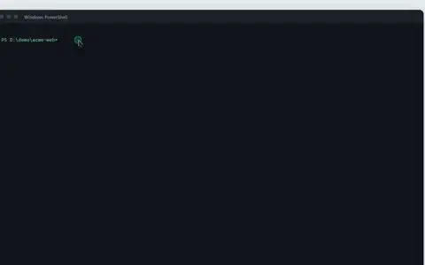
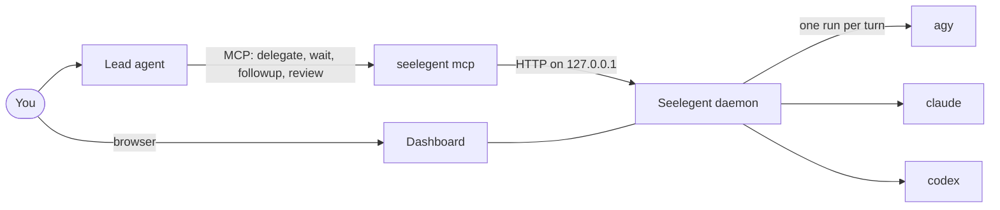
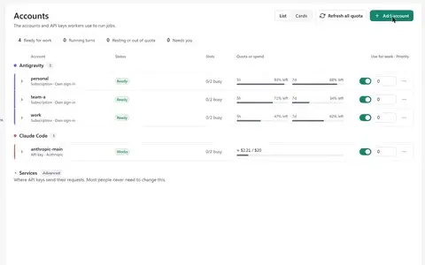
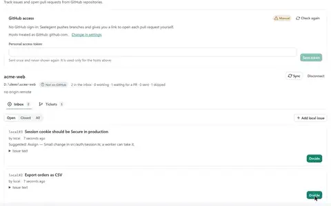
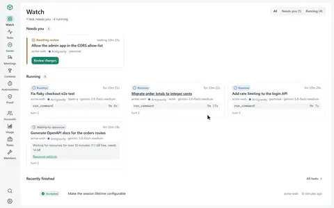

# Usage guide

This guide is for everyday work with Seelegent, one task at a time: what to do, where to click, which command to
run. Each section ends with a link to the page that has every detail. New to Seelegent? Do the first run with
[Getting started](getting-started.md), then come back here.

- [Install and set up](#install-and-set-up)
- [What a task goes through](#what-a-task-goes-through)
- [Add accounts](#add-accounts)
- [Delegate from the lead](#delegate-from-the-lead)
- [Watch tasks in the dashboard](#watch-tasks-in-the-dashboard)
- [Follow up and review](#follow-up-and-review)
- [Quota and handover](#quota-and-handover)
- [Gates and proof](#gates-and-proof)
- [The git guard and restoring work](#the-git-guard-and-restoring-work)
- [Work as a team](#work-as-a-team)
- [GitHub tickets](#github-tickets)
- [Automations](#automations)
- [Resources](#resources)
- [Doctor and troubleshooting](#doctor-and-troubleshooting)
- [Data and privacy](#data-and-privacy)
- [Update and uninstall](#update-and-uninstall)
- [Coming from the old version](#coming-from-the-old-version)

## Install and set up

1. Install with one line. Windows (PowerShell):

   ```powershell
   irm https://raw.githubusercontent.com/NovaSeele/Seelegent/main/scripts/install.ps1 | iex
   ```

   Linux and macOS:

   ```sh
   curl -fsSL https://raw.githubusercontent.com/NovaSeele/Seelegent/main/scripts/install.sh | sh
   ```

2. Open a new terminal and run `seelegent doctor`. A `warn` is fine on a fresh install (no daemon, no account yet); a
   `fail` comes with a fix.
3. The installer has already run `seelegent setup`, which registers the `seelegent` MCP server with every lead host
   it finds, out of nine it knows. Claude Code, Codex CLI, OpenCode and the Antigravity CLI also get the lead skill;
   Claude Desktop, the Antigravity app, Gemini CLI, Cursor and Windsurf get the MCP entry only. Run it again after
   you install a new host:

   ```sh
   seelegent setup --dry-run          # show what would change
   seelegent setup --host claude,codex
   ```

   Restart each host afterwards. Its `seelegent` server should list 17 tools. Claude Code users can add `--hooks`
   for a reminder that nudges the lead to delegate instead of starting its own coding subagents.
4. `seelegent ui` starts the daemon when needed and opens the dashboard at http://127.0.0.1:47821/.

<p align="center">
  <a href="media/setup-doctor.mp4"></a>
</p>

More: [installer options](release.md#installing), [what setup writes for each host](setup.md#seelegent-setup).

## What a task goes through



**Accounts.** Three backends (`agy`, `claude`, `codex`) and three kinds of account: an isolated profile with its own
sign-in, the sign-in already on this computer (`agy` only), or an API key of a provider (`claude` and `codex` only:
Anthropic, DeepSeek, Moonshot Kimi, Z.ai GLM, OpenRouter, OpenAI, Groq, a local Ollama, or a custom endpoint). The
pool reads each account's quota windows and prefers higher priority, fewer running tasks and more quota left. Model
tiers `fast`, `standard`, `strong` and `max` map to real models per backend.

**Tasks.** A task is a conversation: `delegate`, then `followup` as often as needed, then `review` with `accepted`
or `rejected`. Tasks run in parallel, can wait for each other (`after`), get the project's memory and review history
in every brief, can run as a worker role (rules, output style, skills, default tier), and can take a Spec Kit feature
folder and task ids instead of the whole spec. Tasks that stall, loop or ask a question wake the lead early, and tasks
that need you (a sign-in, no account left) go to the top of the dashboard. You can take a task over in a console
and hand it back.

**Gates, lanes and proof.** After every worker report the daemon runs the task's gate: the lead's commands and the
spec's `Gate:` lines, plus, with `--gate-detect` (`gate: true`), the repository's detected test, lint and build
commands, then the project doctrine, syntax checks and the hygiene check. A red gate goes back to the worker as an
automatic fix turn (2 by default) before the lead is woken. Lanes list the files a task may change, so parallel
workers stay off each other's files. An optional verifier reviews a green gate read-only.

**Team, GitHub and automations.** Members are named workers with a backend, a model or tier, a role and a rank
(`worker`, `senior`, `peer`); a peer's objection in a consult blocks acceptance until the lead answers it. Event
hooks run your own shell commands on task, account and daemon events. A connected repository's issues become tickets;
once the work is accepted and you or the lead ask for it, Seelegent commits, pushes the ticket branch, opens a draft
pull request and follows its CI checks. It uses `gh` when it is signed in, else a token you store in the dashboard,
else a manual mode with a compare link. Automations run on a schedule (hourly, daily, weekdays, weekly or cron, in a
time zone) with a precheck command and quota rules.

More: [task engine](task-engine.md), [gates](gates.md), [team](team.md).

## Add accounts

1. **Turn on the backends you want.** `agy` (Antigravity CLI, Gemini models) is on by default. For `claude` or
   `codex`, open **Settings › Backends**, turn the backend on and give each tier (`fast`, `standard`, `strong`,
   `max`) a model id.
2. On **Accounts**, choose **Add account** and say how the account connects:
   - **Sign in with a subscription**: pick Gemini (Antigravity), Claude Pro or Max (Claude Code) or ChatGPT
     (Codex), give it a name, and choose **Sign in**. The worker CLI's own sign-in starts at once, in your browser or
     a terminal window, or asks you to paste a code; the dialog shows it until it is done, and the account's
     **Sign in** button tries again later. Seelegent never sees your password. **Use the sign-in already on this
     computer** (Antigravity only) adds the account on the sign-in you already have.
   - **Use an API key**: choose the service (your own services first, with how many keys each has, then Anthropic,
     DeepSeek, Moonshot Kimi, Z.ai GLM, OpenRouter, OpenAI, Groq, a local Ollama, or "Other" for any Anthropic- or
     OpenAI-compatible address) and paste the key. A key that starts with `sk-ant-`, `sk-or-` or `gsk_` picks its
     service by itself. The field checks the key as the daemon does: a web address or a key with spaces inside is
     refused before anything is sent, and a pasted `.env` line (`ANTHROPIC_API_KEY=sk-…`) or quotes are cleaned.
     The model defaults to **Let the lead choose**: each task names its model. **Different model per tier** sets a
     model for `fast`, `standard`, `strong` and `max` instead. **More options** has the name, the priority (higher
     numbers are used first) and a budget; **Advanced** has the base URL, wire API and extra models.
     **Test and add** checks the key with the service and adds the account only when it works; if the test fails,
     the reason is shown and **Add without testing** adds it anyway.
3. An account that waits for you (no key, signed out, a key the service refused, no credit left, budget reached) is
   listed under **Needs you** at the top of the page, with the button that fixes it.

An API-key account only takes tasks that ask for its service: it is "used when a task asks for Anthropic
(`provider: anthropic`)", as its row says. Its row shows the key test ("Works", "Not tested", "Refused") and, in
place of quota, what the key has spent. Where the amount comes from depends on the service:

- **OpenRouter** counts each key's spend itself: the row shows that count, with today, this week and this month in
  its tooltip. A key with its own limit at OpenRouter offers **Use the key's OpenRouter limit** as its budget in one
  click.
- A service with **prices** (see below) shows its tokens at your prices.
- **Anthropic** without prices shows Claude Code's own estimate, marked "≈": it is not the service's bill.
- A local service (Ollama, localhost) says "Local · free".
- Any other service shows the tokens used, with **Set prices to see cost**.

DeepSeek and Moonshot report the balance of the whole service account, shared by every key on it, so it shows beside
the spend as, for example, "Balance ¥187.60 (account-wide, read 2 min ago)", in the currency the service uses. A
balance that may be out of date or cannot pay for requests says so, and a failed reading says why.

**Set budget** gives the key a budget in US dollars; with **Stop using this key when the budget is used up** ticked,
the key rests once its spend reaches the budget, until you raise the budget or replace the key. A budget on a service
that has no cost to judge it by waits for that service's prices. Open a row (or use its ⋯ menu) for **Test again**,
**Replace key**, **Change model** (it applies to every key of that service), **Set budget**, **Set prices**,
**Rename**, **Turn off** and **Remove**.

**Services** (at the bottom of the page, under Advanced, and in **Settings › API providers**) lists where API keys
send their requests: each service's address, tier models, allowed models and key count, with **Add key** to add
another key to it. A service that keys still use cannot be deleted; the confirmation names those accounts.
**Prices** sets what a service charges, in US dollars per 1M tokens: one row per model for input, cached input
(empty means the input price), cache write and output, with `*` for any model without its own row. Cache write is
the price of a five-minute prompt-cache write; left empty it follows Anthropic's rule, 1.25 × the input price, and
one-hour writes cost 2 × the input price (1.6 × the cache write price when you set one). Seelegent ships no prices;
the form links the service's own price page when it has one. New prices count from then on, and an empty table
removes them.

Add several accounts of the same backend to use several subscriptions. Turn **Use for work** off to keep an account
without using it for now.

<p align="center">
  <a href="media/accounts.mp4"></a>
</p>

More: [accounts and sign-in](getting-started.md#2-accounts-and-sign-in), [backend settings](configuration.md).

## Delegate from the lead

Open your lead host in a project folder (a git repository) and ask for work the way you would ask a colleague,
mentioning Seelegent:

> Use Seelegent to add a `--verbose` flag to the CLI that prints each step. Have a worker write it, then check the
> diff and run the tests before you accept it.

The lead skill tells the lead what to do. The loop uses four MCP tools:

| Tool | When the lead uses it |
|---|---|
| `delegate` | Start a task with a brief written like a ticket (goal, files, constraints, acceptance criteria, how to verify) and the project folder as `cwd`. It waits for the worker's report (600 seconds by default). |
| `wait` | Wait for one or more running tasks; `any: true` returns at the first that ends. |
| `followup` | Send concrete fixes or the next step; the same worker continues its conversation. |
| `review` | Close the task as `accepted` or `rejected`, with notes that later briefs show to workers. |

All 17 tools the `seelegent` MCP server offers the lead:

| Tool | What it does |
|---|---|
| `delegate` | Start a task (or a contest) and wait for the worker's report. |
| `wait` | Wait for one or more tasks; `any: true` returns at the first. |
| `followup` | Send the next instruction or fixes on a task. |
| `review` | Close a task as `accepted` or `rejected`, with notes. |
| `cancel` | Stop a running or queued task. |
| `task` | A task's report and its recent worker steps. |
| `status` | Accounts and quota, active tasks, backends. |
| `memory` | Per-project notes included in every brief. |
| `profiles` | Worker roles: rules, output style, skills, default tier. |
| `proof` | Requirement matrix, regression runs, lane claims, statistics. |
| `members` | The department members. |
| `consult` | A second opinion on a finished task from a senior or peer. |
| `notes` | Review notes on a task's diff, sent as one followup. |
| `meeting` | A structured meeting of members before a decision. |
| `contest` | Follow a contest, pick the winner. |
| `issues` | GitHub issues to tickets, worktrees and draft pull requests. |
| `automations` | Scheduled delegations. |

`seelegent setup` also installs the lead skill, which teaches the lead this loop; `seelegent skill` prints it. Every
tool except `profiles` has a `seelegent` command (worker roles are edited on the **Roles** page and through the
`profiles` tool), and every command takes `--json`.

Pick a tier for the work: `fast` for lookups and mechanical edits, `standard` for most work, `strong` or `max` for
hard, multi-file changes. Several tasks can run in parallel; give each its own files (a lane) so they do not edit
the same ones.

Without an MCP host, the same loop works from a terminal:

```sh
seelegent delegate --cwd . --model fast --gate-detect "Add a --verbose flag to the CLI that prints each step"
seelegent delegate --cwd . --wait 0 "..."        # return at once with the task id
seelegent wait <id> --seconds 600
seelegent ls --active
```

Facts every worker should know (build commands, conventions, pitfalls) go into the project's memory, which is added
to every brief: the `memory` tool, `seelegent memory append --cwd . "..."`, or **Settings › Memory**.

<p align="center">
  <a href="media/delegate.mp4"></a>
</p>

More: [every MCP tool and its arguments](mcp.md), [every command](cli.md), [the lead skill](setup.md#skill).

## Watch tasks in the dashboard

- **Watch** is the home page: what **needs you** at the top, what is running (current step, tokens, changed files),
  what finished recently, and a strip of accounts with their state.
- **Needs you** lists tasks with a banner that says what to do: answer a question, sign an account in, restore
  files at risk, or follow up on a red gate. The same tasks are under the **Needs you** filter of **Tasks**.
- **Tasks** lists every task with filters and search. Open one for its header (status, account, model, actions),
  its gate and safety panels, and five views: **Terminal** (the conversation and every tool call), **Tree** (turns,
  attempts and steps), **Graph** (steps over time), **Files** (what the worker read or edited) and **Git** (the
  task's commits and uncommitted changes, file by file). The Git view previews changed images; it shows no
  preview for an image reached through a symbolic link or a Windows junction, even one that points inside the
  repository.
- **Take over** opens the worker's conversation in a console on the same account; when you close it, the worker
  writes a hand-back report.

`Ctrl+K` opens the command palette and `Ctrl+,` the settings (`Cmd+K` and `Cmd+,` on macOS). The dashboard comes in
seven languages (English, Tiếng Việt, 简体中文, Español, 한국어, 日本語, Русский) and follows your browser's language unless
you pick one in **Settings › Language**.

<table>
  <tr>
    <td width="50%" align="center">
      <a href="media/needs-you.mp4"></a><br>
      <b>Needs you</b>
    </td>
    <td width="50%" align="center">
      <a href="media/task-detail.mp4"></a><br>
      <b>Task detail</b>
    </td>
  </tr>
</table>

More: [a tour of the dashboard](getting-started.md#4-a-tour-of-the-dashboard), [task states and
attention](task-engine.md#attention).

## Follow up and review

A task stays open until it gets a verdict. Read the diff in the **Git** view (or let the lead read it), run the
tests, then:

- **Follow up** with concrete fixes: the **Follow up** box under the task (you can pick another tier or model for
  that turn), the lead's `followup`, or `seelegent followup <id> "Also handle the empty input case"`.
- **Leave review notes** on lines of the diff in the **Git** view and send them all as one followup. Each note
  follows its line across turns and shows whether the next turn addressed it.
- **Accept** or **Reject**: the buttons on the task, the lead's `review`, or
  `seelegent review <id> accepted --notes "..."`. When a review teaches something workers should always do, the
  lead's `rule` (or `--rule "..."`) keeps it as one line under "Lessons from reviews" in the project's memory, which
  every later brief carries ([mcp.md](mcp.md#lessons-from-reviews)).

Accepting does not commit anything. Commit the accepted work yourself, or with the **Commit…** dialog of the Git
view, which commits only the files you tick.

More: [follow up and review](getting-started.md#6-follow-up-and-review), [review notes](team.md#review-notes).

## Quota and handover

- The daemon reads every account's quota windows every 10 minutes (`quotaRefreshMinutes`) and picks the account
  for each turn by priority, then the fewest running tasks, then the most quota left.
- An account at or below 3% of a window (`minRemaining`) rests until that window resets. When an account runs out
  in the middle of a task, the task moves to another account with a handover of what happened so far.
- When no account can run a task, it shows **Waiting for quota** (it starts by itself after a reset) or **No
  accounts left** (add or turn on an account). It shows **Waiting for a free slot** when every account that could
  run it is at its per-account limit (`maxConcurrentPerAccount`, or the `maxConcurrentWorkers` cap) although quota
  is left, with the full accounts (`acc6: 2 of 2 running`); it starts when one of their tasks ends.
- `seelegent status` (or the lead's `status`) shows each account's quota and every queued, running or waiting
  task, the ones that need you first; **Usage** shows
  tokens, cost, tasks and turns over 7 or 30 days, and each account's quota over time.

More: [quota settings](configuration.md#accounts-quota-and-timeouts), [a run, turn by turn](task-engine.md#a-run).

## Gates and proof

- After every worker report the daemon runs the task's **gate**: the lead's commands (`--gate`, or the `gate`
  argument of `delegate`) and the spec's `Gate:` lines, plus, with `--gate-detect` (`gate: true`), the repository's
  detected test, lint and build commands, plus syntax and hygiene checks.
- A red gate goes back to the worker as an automatic fix turn, twice at most by default, before the lead is woken.
  When the fix turns are used up the task shows **Gate failed**: read the failing steps in the gate panel, then
  follow up or reject.
- **Lanes** list the files a task may change (`--lane`), so parallel workers stay off each other's files.
- `--verify` runs a read-only second-opinion verifier once the gate is green.
- With a Spec Kit feature (`--spec` and `--task`), the **Proof** page shows which requirements are proven and runs
  regression runs of every gate command (`seelegent proof matrix <feature>`, `seelegent proof run`).

<p align="center">
  <a href="media/gates-proof.mp4"></a>
</p>

More: [gates, lanes and proof](gates.md).

## The git guard and restoring work

- Workers cannot run git commands that can throw away uncommitted work or rewrite history (`reset`, `restore`,
  `stash`, `checkout` except `checkout -b`, `switch`, `clean`, `rebase`, `merge`, `pull`, `push`, `commit -a`,
  `--amend` and more), also inside shells, interpreters, pipes or git aliases. When a worker should commit, the lead
  can lift the guard with `allow_git` (`--allow-git`). It applies to the current command only: the `delegate` or
  `followup` that set it, that turn and its automatic fix turns. A later `followup` must pass it again.
- Before and after every turn Seelegent records the repository's uncommitted files, without touching your index,
  stash or refs. Files a turn may have lost show up as **work at risk** with the banner **Work may be lost**.
- Restore them with **Restore files** in the task's **Safety checks** panel (once the worker has stopped), or
  `seelegent restore <id> --turn N [--file path]`. The current content is kept in a backup snapshot first. Files
  changed again after the turn ended are skipped unless you choose **Restore anyway** (`--force`).
- Post-turn checks also report line-ending and BOM changes, stray files, writes outside the project and files other
  tasks changed too. Red hygiene (line endings, a BOM, junk files) makes the gate red, which sends the worker an
  automatic fix turn; the guard, the snapshots and the other checks only tell the lead and the dashboard what
  happened.
- A worker cannot call Seelegent itself (it cannot start, change or review tasks), cannot turn on an automation and
  cannot store a GitHub token. Only you, in the dashboard, can do the last two.
- Before a push, Seelegent scans every file it adds, and it pushes one commit of its own, never the worker's commits:
  `.env` files, keys and certificates, credential files, tokens in file content, Windows device names such as `nul`
  and files over 5 MB refuse the push, with no override. It never force-pushes, merges or closes issues.

These are guards, not a sandbox: worker CLIs run as your user, so review what they changed. To report a security
problem, see [SECURITY.md](../SECURITY.md).

<p align="center">
  <a href="media/git-guard.mp4"></a>
</p>

More: [safety](safety.md).

## Work as a team

- **Members** are named workers with a backend, a model or tier, a role and a rank (`worker`, `senior`, `peer`).
  Add them with **New member** on the **Members** page or with `seelegent members add`; delegate to one with
  `--member` (the `member` argument).
- **Consult**: ask a senior or peer for a second opinion on a finished task (`consult`,
  `seelegent consult <id> --member M`). A peer's objection blocks acceptance until the lead answers it.
- **Meeting**: before a hard decision, up to six members answer the same question; the lead decides and can turn
  the decision into tasks (`meeting`, the **Meetings** page). A peer may record a formal dissent.
- **Contest**: run one brief as 2 to 5 variants in separate worktrees (`--variants 3`, or `--variant` per variant),
  score them, and apply the winner to your working tree (`seelegent contest pick`, the **Contests** page).
- **Event hooks** run your own shell commands on task, account and daemon events (**Settings › Hooks**,
  `seelegent hooks`).

<p align="center">
  <a href="media/team.mp4"></a>
</p>

More: [team](team.md).

## GitHub tickets

1. On **Issues**, connect a repository on this computer (or `seelegent issues connect`). Seelegent reaches GitHub
   through `gh` when it is signed in, else a token you store on **Issues** (only you can store it, in the
   dashboard), else a manual mode with a compare link.
2. **Sync** brings its open issues into the inbox; you can also add local issues.
3. **Triage** an issue: `assign` makes a ticket with its own worktree and branch (`seelegent/<n>-<slug>`) and starts
   a task there; `meeting` opens a meeting first; `skip` records why not.
4. Once the ticket's work is accepted, **Open pull request** (the lead's `pr` action) commits, pushes the ticket
   branch and opens a draft pull request, after a secret scan of every added file. Nothing is pushed until you or the
   lead ask. Seelegent then follows the CI checks, and **Fix checks** (`fix-checks`) starts a task with the failing
   ones.

Your own checkout is never changed, and Seelegent never force-pushes, merges or closes issues.

More: [GitHub](github.md).

## Automations

- An automation is a saved delegation on a schedule (hourly, daily, weekdays, weekly or cron, in a time zone), with
  an optional precheck command and quota rules: a run is skipped when quota is low, and an optional extra run uses
  a weekly quota that is about to reset unused.
- Every automation is created **Off**. The lead (or `seelegent automations enable`) can only ask; you confirm
  exactly what it runs on the **Automations** page. Any change to what it runs or when turns it off again.
- `seelegent automations preview` shows the next run times, `run` starts one run now, `runs` shows the history.

<p align="center">
  <a href="media/github-automations.mp4"></a>
</p>

More: [automations](automations.md).

## Resources

Seelegent shares the machine with your own programs, so it holds back new work when the machine is busy.

- Five settings are **auto** by default and computed from this machine's memory and CPUs (a container's limits
  included): `gateConcurrency` (gate commands at once), `minFreeMemoryMB` and `minFreeCommitMB` (a new worker turn or
  gate command waits below these), `criticalFreeMemoryMB` (the emergency floor that stops the newest gate command)
  and `testParallelism` (the `-p`/`-j` hint for tests and builds). A 4 GB laptop and a 128 GB workstation each get
  values that suit them.
- **Settings › Resources** shows each value in use and where it comes from. **Set** opens the field at the value in
  use so you can pin your own; **Use auto** returns a setting to the value computed for this machine.
- Other resource settings: worker and gate process priority (low by default), `maxConcurrentWorkers` over all
  accounts, and, on Windows, a memory and CPU cap per worker tree.
- A task held back for memory shows **Waiting for resources**. `seelegent doctor` (check `resources`) compares free
  memory with the thresholds and suggests values when the machine is usually below them.

<p align="center">
  <a href="media/resources.mp4"></a>
</p>

More: [resource settings and their formulas](configuration.md#resources),
[the start check and the memory watchdog](task-engine.md#resources-the-start-check-and-the-memory-watchdog).

## Doctor and troubleshooting

- `seelegent doctor` checks the data folder, settings, database, daemon, git, each enabled worker CLI, accounts, PATH
  and free memory against the resource thresholds, and says how to fix what fails. It changes nothing apart from a
  write test in the data folder (`.doctor-write-test`, removed again).
- `seelegent status` shows the daemon, the backends, each account's quota and every queued, running or waiting
  task, the ones that need you first.
- `seelegent task <id> --steps 30` prints a task's report and its last worker steps; `--full --json` prints the
  whole task (`--full` alone, as text, prints only a short header).
- `seelegent restart` restarts the daemon; running workers keep running and are picked up again. Its log is
  `~/.seelegent/logs/daemon.log` (secrets masked).
- A lead whose `wait` times out loses nothing: the task keeps running, and `wait` picks it up again.
- `seelegent setup --dry-run` shows what is registered with each lead host. Restart a host after setup or update.
- "Seelegent is not available inside a Seelegent worker." means a worker tried to call Seelegent; that is refused on
  purpose.
- A task stuck in **Needs you** says why on its banner: answer its question, sign an account in, restore files at
  risk, or follow up on a red gate.

More: [when something is stuck](getting-started.md#7-when-something-is-stuck), [doctor's checks](cli.md#doctor).

## Data and privacy

- Everything runs on your machine. The daemon listens on `127.0.0.1` only. Seelegent itself sends no telemetry; the
  worker CLIs follow their own settings.
- Data lives in `~/.seelegent` (set `SEELEGENT_HOME` to move it): `config.json` (settings), `seelegent.db` (tasks,
  accounts, usage, team, tickets, automations), `tasks/` (each attempt's prompt, stream, stderr and gate logs; as
  sensitive as your code: the workers' full transcripts), `profiles/` (one isolated profile per account, with its
  API key), `github/` (the token), `snapshots/` (turn snapshots, including the backup taken before a restore),
  `backups/` (copies taken before migrations and imports), `guard/` (the git guard's files), `contests/` (stored
  contest diffs), `worktrees/` (only for contests and tickets), `run/` and `logs/`.
- Seelegent never asks for passwords. Each worker CLI signs in with its own flow and keeps its tokens in the account's
  profile. API keys and the GitHub token are each stored in their own file, encrypted with DPAPI on Windows and as
  owner-only (0600) plain text elsewhere; the dashboard shows only their last four characters, and logs mask secrets.
- What leaves the machine: the worker CLIs talk to their own providers (that is the work), quota is read through the
  CLIs (and, for Claude sign-ins, from Anthropic's usage endpoint with that account's own sign-in), API-key accounts
  call the provider you configured, and GitHub is called only for repositories you connect (syncing, a poll of
  their issues and pull requests every 10 minutes, which `githubPollMinutes: 0` turns off, and the pushes, pull
  requests and comments you or the lead ask for), to check your GitHub sign-in when you open **Issues**, and by the
  installers and `seelegent update`.

More: [the data folder and every setting](configuration.md).

## Update and uninstall

`seelegent update` tells you whether a newer release exists; `seelegent update --apply` installs it in place (checked
against the release's `checksums.txt`, daemon restarted, lead hosts refreshed) and `seelegent update --rollback` goes
back to the version the last update replaced. The database is never migrated backwards, so a release older than your
data is refused.

To uninstall:

1. `seelegent stop`, then `seelegent setup --remove` (removes the MCP entries, the lead skill and the hook).
2. Delete the binary, its companion launcher `seelegent-launch.exe` (`seelegent-launch`) and the kept `.previous`
   files next to them:
   `%LOCALAPPDATA%\Programs\seelegent\bin\` on Windows, `~/.local/bin/seelegent*` elsewhere. Remove that folder from
   your PATH (the user `Path` on Windows, the `export PATH=...` line the installer added to your shell profile
   elsewhere).
3. Optionally delete `~/.seelegent`. It holds your account profiles (and their sign-ins), keys, tasks and history.

More: [updating](release.md#updating).

## Coming from the old version

The old Node version kept its data in the same folder. On the first install the installer runs `seelegent migrate`,
which imports settings, providers, accounts with their profiles and API keys, project memory and review history,
roles, members, hooks, meeting records and automations (every automation off, to confirm again). Tasks, review
notes, contests, proof records, usage history and the GitHub folder are not imported: connect your repositories and
store the token again. The old folder is never changed. On Windows, if the old launcher is in the install folder, it
is kept as `seelegent-node.cmd`. Stop the old daemon before you install, and run `seelegent migrate --dry-run` to see
what would be imported.

More: [seelegent migrate](setup.md#seelegent-migrate).
